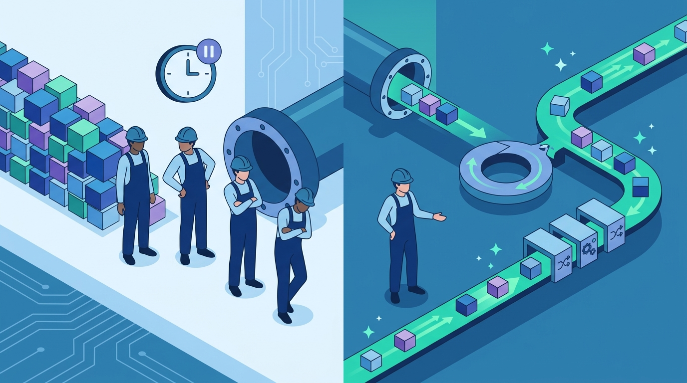
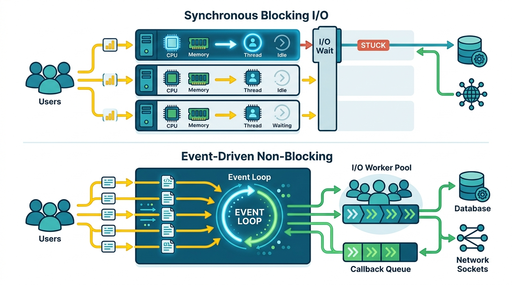

> 이 글은 **[Spring MVC vs WebFlux, 언제 무엇을 써야 할까? 차이점 쉽게 정리](/posts/spring-mvc-vs-webflux-when-to-use/)** 에서 이어지는 시리즈 2편입니다. 앞 글에서 WebFlux와 MVC의 차이를 봤다면, 이번 글에서는 그 핵심 배경인 **Blocking** 과 **Non-blocking** 을 조금 더 쉽게 풀어보겠습니다.

Spring WebFlux를 설명할 때 가장 자주 나오는 단어가 있습니다. 바로 **blocking** 과 **non-blocking** 입니다.

그런데 많은 분들이 이 개념을 처음 접할 때 이렇게 느낍니다.

- 단어는 익숙한데 정확히 무슨 차이인지 잘 모르겠다
- 비동기와 같은 말인지 헷갈린다
- non-blocking이면 무조건 빠른 건가 싶다
- 실무에서 왜 중요한지 감이 안 온다

사실 이 개념은 WebFlux만의 이야기가 아닙니다. 백엔드 서버가 요청을 어떻게 처리하고, 자원을 어떻게 쓰는지 이해하려면 한 번은 정확히 짚고 넘어가야 하는 주제입니다.

이번 글에서는 어렵게 이론만 설명하기보다, **"기다리는 방식이 어떻게 다르냐"** 라는 관점으로 blocking과 non-blocking을 쉽게 정리해보겠습니다.

## 먼저 결론부터

시간이 없으면 아래 내용만 먼저 보셔도 됩니다.

- **Blocking은 작업이 끝날 때까지 현재 흐름이 기다리는 방식**입니다.
- **Non-blocking은 기다리는 동안 다른 작업을 할 수 있게 설계된 방식**입니다.
- **Non-blocking이 항상 더 좋은 것은 아닙니다.**
- **I/O 대기가 많고 동시성이 중요한 상황에서는 non-blocking의 장점이 커질 수 있습니다.**
- **일반적인 CRUD 서비스에서는 blocking 방식이 더 단순하고 유지보수하기 쉬운 경우도 많습니다.**

핵심은 "무엇이 더 최신인가"가 아니라, **"어떤 문제를 해결하려는가"** 입니다.

## Blocking이란 무엇인가

가장 쉽게 말하면, **어떤 작업이 끝날 때까지 현재 작업이 멈춰서 기다리는 것**이 blocking입니다.

예를 들어 서버가 데이터베이스에 사용자 정보를 요청했다고 가정해보겠습니다.

1. 서버가 DB에 쿼리를 보냅니다.
2. 결과가 돌아올 때까지 기다립니다.
3. 결과를 받은 다음에 다음 코드를 실행합니다.

이때 기다리는 동안 현재 스레드는 그 작업에 묶여 있게 됩니다.

즉, "지금 이 일 끝날 때까지 다른 일은 잠깐 못 한다"에 가까운 흐름입니다.

### 일상 비유로 보면

카페에서 주문을 받는 직원이 한 명 있다고 생각해보겠습니다.

- 손님 A의 주문을 받음
- 커피가 완성될 때까지 그 자리에서 계속 기다림
- 커피를 받은 다음에야 손님 B 주문을 받음

이게 blocking에 가까운 느낌입니다.

구조는 단순하고 이해하기 쉽습니다. 하지만 기다리는 시간이 길어질수록 전체 처리량은 떨어질 수 있습니다.

## Non-blocking이란 무엇인가

반대로 non-blocking은 **기다려야 하는 작업이 있어도, 그동안 다른 일을 할 수 있게 만드는 방식**으로 이해하면 쉽습니다.

같은 예시를 다시 보면,

1. 서버가 DB에 쿼리를 보냅니다.
2. 결과가 올 때까지 가만히 붙잡혀 있지 않습니다.
3. 그 사이 다른 요청이나 다른 작업을 처리합니다.
4. 결과가 준비되면 이어서 후속 작업을 진행합니다.

즉, 기다림 자체가 사라지는 건 아니지만, **기다리는 동안 자원을 덜 낭비하는 방향**입니다.

### 일상 비유로 보면

아까 카페 예시를 다시 가져오면,

- 손님 A 주문을 받음
- 커피 제조 요청을 넘김
- 커피가 나오는 동안 손님 B, C 주문도 계속 받음
- 준비된 주문이 나오면 해당 손님에게 전달함

이게 non-blocking에 더 가깝습니다.

그래서 대기 시간이 긴 작업이 많을수록 이런 방식이 유리할 수 있습니다.

## 중요한 포인트: 기다림이 없다는 뜻은 아니다

여기서 많이 오해하는 부분이 있습니다.

**non-blocking = 기다리지 않음**

이건 정확하지 않습니다.

외부 API 응답이나 DB 조회는 여전히 시간이 걸립니다. 네트워크 지연이 갑자기 사라지는 건 아닙니다. 차이는 **그 시간을 보내는 방식**입니다.

- blocking: 결과가 올 때까지 현재 흐름이 멈춤
- non-blocking: 결과를 기다리는 동안 다른 일을 처리함

즉, 더 정확히 말하면 non-blocking은 **대기 시간을 더 효율적으로 활용하는 방식**에 가깝습니다.

## 동기/비동기와는 같은 말일까

이 부분도 자주 헷갈립니다.

Blocking / Non-blocking 과 Sync / Async 는 관련은 있지만 완전히 같은 축은 아닙니다.

### 단순하게 구분하면

- **Blocking / Non-blocking**: 기다리는 방식
- **Synchronous / Asynchronous**: 결과를 전달받는 방식 또는 흐름 제어 방식

그래서 이론적으로는 조합이 나뉠 수 있습니다.

- synchronous blocking
- asynchronous non-blocking
- asynchronous blocking
- synchronous non-blocking

실무에서는 보통 blocking vs non-blocking을 설명할 때 async 이야기가 같이 따라오지만, 둘을 완전히 같은 말처럼 이해하면 나중에 개념이 꼬일 수 있습니다.

## 왜 백엔드에서 이게 중요할까

백엔드 서버는 보통 한 번에 많은 요청을 받아 처리합니다.

문제는 많은 요청이 항상 CPU 계산만 하는 게 아니라는 점입니다. 실제로는 아래 같은 대기 시간이 더 많습니다.

- 데이터베이스 조회 대기
- 외부 API 응답 대기
- 파일 읽기/쓰기 대기
- 네트워크 I/O 대기

이런 작업이 많은 시스템에서는 CPU보다 **I/O 대기**가 병목이 되는 경우가 많습니다.

이때 blocking 방식은 요청마다 스레드가 묶이기 쉬워지고, 동시 요청이 많아질수록 스레드 사용량도 커집니다.

반면 non-blocking 방식은 대기 시간 동안 다른 요청을 처리할 수 있어서, 자원을 더 효율적으로 쓸 가능성이 있습니다.

## 그렇다면 non-blocking이 무조건 좋은가

결론부터 말하면 **아닙니다.**

이 부분이 실무에서 가장 중요합니다.

### Non-blocking이 더 잘 맞는 경우

- 동시에 처리해야 할 연결 수가 매우 많을 때
- 외부 네트워크 호출이 많은 서비스일 때
- 스트리밍이나 실시간 처리 요구가 있을 때
- 제한된 자원으로 높은 동시성을 감당해야 할 때

### Blocking이 더 현실적인 경우

- 일반적인 CRUD 중심 서비스일 때
- 팀이 복잡한 비동기 흐름보다 단순한 구조를 선호할 때
- 라이브러리 생태계와 호환성이 중요할 때
- 디버깅과 유지보수 편의성이 더 중요할 때

즉, 성능만 볼 것이 아니라 **복잡도와 운영 난이도**도 함께 봐야 합니다.

## Spring MVC와 WebFlux에 대입해보면

이제 이걸 Spring으로 연결하면 이해가 더 쉬워집니다.

### Spring MVC

Spring MVC는 보통 blocking 기반 request-response 모델로 이해하면 됩니다.

- 요청이 들어오면 스레드가 할당되고
- DB나 외부 API 작업을 기다리고
- 결과를 받은 뒤 응답을 반환합니다.

이 구조는 단순하고, JPA 같은 전통적인 생태계와 잘 맞습니다.

### Spring WebFlux

WebFlux는 non-blocking과 reactive 흐름을 적극적으로 활용합니다.

- 요청 처리 중 대기 시간이 생겨도 자원을 더 효율적으로 쓰고
- 많은 동시 요청과 스트리밍 처리에 유리할 수 있습니다.
- 대신 코드 흐름과 디버깅 방식이 더 낯설 수 있습니다.

즉, WebFlux를 이해하려면 먼저 blocking과 non-blocking의 차이를 이해해야 합니다.

## 헷갈리기 쉬운 오해 정리

### Non-blocking이면 무조건 더 빠르다?

아닙니다. CPU 연산이 많은 작업에서는 체감 차이가 크지 않을 수 있습니다.

### Blocking은 무조건 구식이다?

전혀 아닙니다. 지금도 수많은 실무 서비스가 blocking 기반으로 안정적으로 운영됩니다.

### Non-blocking이면 코드가 더 간단하다?

오히려 반대인 경우가 많습니다. 자원 활용은 좋아질 수 있지만, 코드 흐름은 더 복잡해질 수 있습니다.

### 결국 중요한 건 무엇인가

가장 중요한 건 **서비스의 병목이 어디에 있는지** 입니다.

- CPU 계산이 문제인지
- I/O 대기가 문제인지
- 동시 연결 수가 문제인지
- 유지보수 복잡도가 더 큰 문제인지

이걸 먼저 봐야 합니다.

## 실무에서 빠르게 판단하는 기준

아래 질문으로 빠르게 정리할 수 있습니다.

### Blocking 쪽이 더 잘 맞는 경우

- 요청 수는 적당하고 구조 단순성이 중요한가?
- 대부분의 기능이 CRUD 중심인가?
- 팀이 익숙한 방식으로 빠르게 개발해야 하는가?
- 운영 중 디버깅과 유지보수가 특히 중요한가?

### Non-blocking을 검토할 만한 경우

- 외부 I/O 대기가 전체 성능에 큰 영향을 주는가?
- 높은 동시 연결을 효율적으로 처리해야 하는가?
- SSE, WebSocket, 스트리밍 응답이 중요한가?
- reactive 흐름을 팀이 감당할 수 있는가?

## 한 줄 요약

**Blocking은 기다리는 동안 멈추는 방식이고, Non-blocking은 기다리는 동안 다른 일을 처리할 수 있게 만드는 방식입니다.**

그리고 중요한 건, non-blocking이 항상 더 우월한 것이 아니라 **I/O 대기가 많은 상황에서 특히 강점을 보일 수 있는 선택지**라는 점입니다.

## 마무리

Blocking과 Non-blocking은 WebFlux를 이해하기 위해서만 필요한 개념이 아닙니다. 백엔드 서버가 자원을 어떻게 쓰고, 왜 어떤 구조가 특정 상황에서 유리한지를 이해하는 데 기본이 되는 개념입니다.

정리하면 이렇습니다.

- **Blocking은 단순하고 이해하기 쉽다**
- **Non-blocking은 자원 활용 면에서 유리할 수 있다**
- **하지만 구조와 디버깅 난이도는 올라갈 수 있다**
- **무엇이 더 좋은지는 서비스 특성과 팀 상황에 따라 달라진다**

다음 글에서는 여기서 한 단계 더 들어가서, WebFlux에서 자주 등장하는 **Mono와 Flux가 무엇인지**를 예시 중심으로 정리해보겠습니다.
