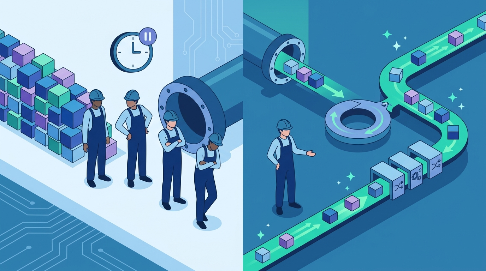
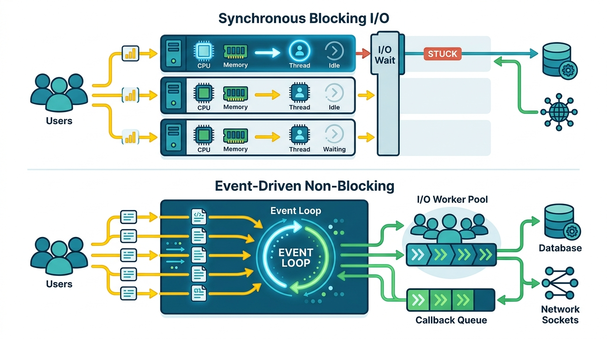

> Korean version: [Blocking vs Non-blocking, 백엔드 개발자라면 꼭 알아야 할 차이](/posts/blocking-vs-non-blocking-in-backend/)

> This is part 2 of the Spring/WebFlux series, following **[Spring MVC vs WebFlux: When Should You Use Each?](/posts/spring-mvc-vs-webflux-when-to-use-en/)**. If the first post explained the big framework choice, this one explains the core execution model behind that choice.

When people talk about Spring WebFlux, one pair of terms shows up almost immediately:

- **blocking**
- **non-blocking**

The problem is that these words get repeated so often that they start sounding familiar before they actually become clear.

A lot of developers run into the same questions:

- I kind of know the words, but what is the real difference?
- Is non-blocking just another way to say asynchronous?
- Does non-blocking always mean faster?
- Why should I care if I am building normal backend APIs?

These are good questions, because this topic is bigger than WebFlux. It is really about how a server waits, how it uses threads, and how it behaves when many requests are active at once.

## Quick summary

If you want the short version first:

- **Blocking means the current flow waits until the work is done.**
- **Non-blocking means the system is designed so that waiting does not tie up the same execution path in the same way.**
- **Non-blocking is not automatically better in every system.**
- **It becomes especially attractive when I/O waiting and concurrency are the real bottlenecks.**
- **For many everyday business applications, blocking code is still simpler and easier to maintain.**

## What blocking means

The simplest definition is this:

**blocking means the current work stops and waits until another operation finishes.**

Imagine a backend service sends a query to a database:

1. it sends the query
2. it waits for the result
3. after the result comes back, it continues

During that wait, the current execution flow is occupied.

That is the key idea.

### An everyday analogy

Imagine one employee at a cafe:

- customer A places an order
- the employee stands there waiting for that drink to finish
- only then does the employee move on to customer B

That is not a perfect systems model, but it captures the feeling of blocking well enough: **the flow is tied up while waiting**.

## What non-blocking means

Now flip the idea.

With non-blocking behavior, the system is structured so that while one operation is waiting, other work can still move forward more effectively.

Using the same database example:

1. the service sends the query
2. it does not sit there in the same way waiting on that result
3. other work can proceed
4. when the result is ready, the next step continues

The waiting has not disappeared. The database is still taking time.

What changed is how the application behaves during that waiting period.

### The same cafe analogy

- customer A places an order
- drink preparation begins
- while the drink is being made, the employee keeps taking orders from customers B and C
- completed drinks are handed out as they become ready

That is the basic intuition behind non-blocking behavior.

## The important nuance: non-blocking does not mean “no waiting”

This is one of the most common misunderstandings.

A remote API still takes time. A database still takes time. Network latency still exists.

So the real difference is not:

- blocking = waiting exists
- non-blocking = waiting disappears

The real difference is closer to this:

- **blocking**: the current flow is held up while waiting
- **non-blocking**: the system is structured to make better use of that waiting time

That is why non-blocking is really about **resource usage during waiting**, not about magic speed.

## Is this the same as sync vs async?

Not exactly.

These pairs are related, but they are not identical:

- **blocking / non-blocking** = how waiting behaves
- **synchronous / asynchronous** = how results are coordinated and delivered through the flow

In theory, these can combine in different ways.

That is why treating them as identical concepts usually causes confusion later.

For day-to-day backend discussion, it is enough to remember this:

**blocking vs non-blocking is mainly about waiting behavior.**

## Why backend developers should care

Most backend systems do not spend all their time doing CPU-heavy calculation.

A surprising amount of real latency comes from waiting on things such as:

- database queries
- external API calls
- file reads and writes
- network I/O

When that kind of waiting dominates the workload, the way the application uses threads and handles concurrency starts to matter a lot.

In a blocking model, many simultaneous waiting requests can consume many waiting threads.

In a non-blocking model, the system may be able to make better use of the same hardware under that kind of load.

## So is non-blocking always better?

No—and this is probably the most important part of the whole discussion.

### Non-blocking tends to shine when:

- there are many simultaneous connections
- there is a lot of outbound network waiting
- streaming or real-time delivery matters
- the system is bottlenecked by I/O rather than CPU

### Blocking is often the more practical choice when:

- the application is mostly CRUD
- code clarity matters more than maximum concurrency efficiency
- the team wants predictable debugging and maintenance
- the surrounding ecosystem is heavily blocking-oriented

That is why good architecture decisions usually come down to trade-offs, not ideology.

## Apply this to Spring MVC and WebFlux

This is where the topic becomes easier to place in the Spring ecosystem.

### Spring MVC

Spring MVC is commonly understood as a blocking request-response model.

A request comes in, a thread handles it, the application waits on I/O where needed, and then a response is returned.

That model is straightforward and fits very naturally with traditional tools such as JPA.

### Spring WebFlux

WebFlux is designed around non-blocking, reactive flows.

That makes it a better fit for workloads where:

- waiting-heavy I/O dominates
- many connections stay active
- streaming is part of the API model

But it also means the code and operational model can become less familiar.

## Common misunderstandings

### “Non-blocking is always faster”
Not necessarily. If CPU work is the real bottleneck, the improvement may be small or irrelevant.

### “Blocking is outdated”
Not at all. Huge numbers of stable production systems still use blocking models successfully.

### “Non-blocking automatically makes code simpler”
Usually the opposite. It can improve efficiency under the right workload, but the logic and debugging model may become more complex.

### “There must be one universally correct answer”
There is not. The right answer depends on where the bottleneck actually is.

## A practical decision guide

### A blocking approach is usually fine if:

- request flow is simple
- most endpoints are CRUD-oriented
- maintainability matters more than concurrency specialization
- the team wants the clearest possible operational model

### A non-blocking approach is worth evaluating if:

- I/O wait is a serious part of response time
- the system needs to handle many concurrent connections efficiently
- streaming or event-style delivery is important
- the team is comfortable with reactive or async flow management

## One-sentence takeaway

**Blocking means the current execution path waits. Non-blocking means the system is designed so that waiting does not tie up work in the same way.**

That difference matters most when I/O waiting and concurrency are real problems, not imaginary future ones.

## Final thoughts

Blocking and non-blocking are not just theory terms for framework documentation. They are core ideas for understanding how backend servers spend time and resources.

A practical summary looks like this:

- **blocking is easier to reason about**
- **non-blocking can use resources better under the right workload**
- **non-blocking also tends to raise complexity**
- **the correct choice depends on the application, not on trendiness**

---

## Spring/WebFlux series

1. [Spring MVC vs WebFlux: When Should You Use Each?](/posts/spring-mvc-vs-webflux-when-to-use-en/)
2. [Blocking vs Non-Blocking in Backend Systems: What Actually Matters?](/posts/blocking-vs-non-blocking-in-backend-en/)
3. [Mono vs Flux in Spring WebFlux: The Core Idea in Plain English](/posts/mono-vs-flux-in-spring-webflux-en/)
4. [When Do You Actually Need Async Processing in Spring Boot?](/posts/when-to-use-async-processing-in-spring-boot-en/)
5. [JPA vs R2DBC in Spring: Which One Fits Your Application?](/posts/jpa-vs-r2dbc-in-spring-en/)
6. [WebFlux in Production: Pitfalls to Watch Before You Adopt It](/posts/webflux-production-pitfalls-en/)
