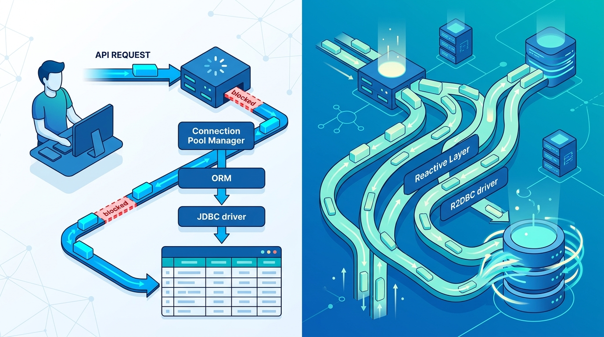
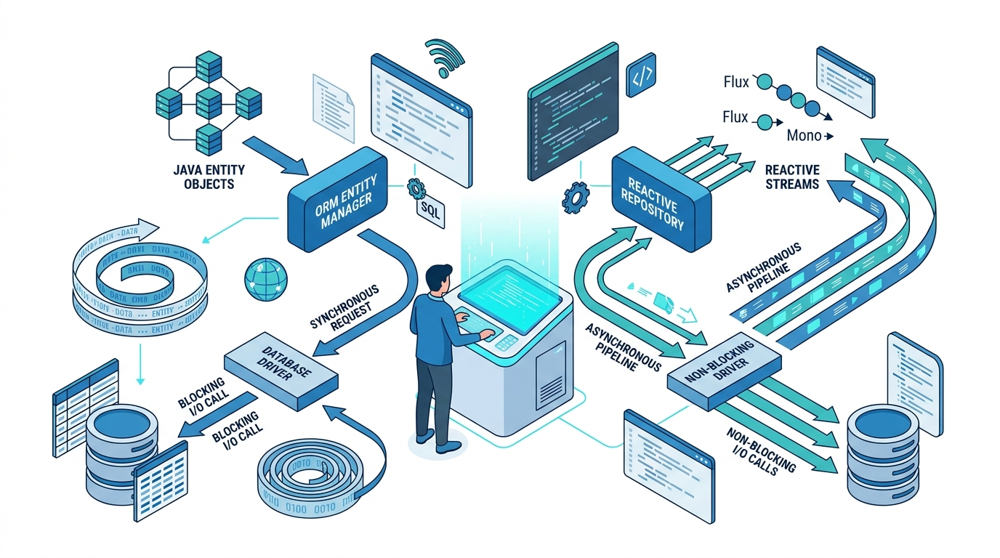

> Korean version: [JPA와 R2DBC 차이점 정리, Spring에서 무엇을 선택해야 할까?](/posts/jpa-vs-r2dbc-in-spring/)

> This is part 5 of the Spring/WebFlux series. By this point, the main question shifts from the web layer to the persistence layer: if you care about blocking vs non-blocking in the web stack, what should happen at the database layer?

Once you start talking seriously about WebFlux, the conversation almost always reaches the same question:

- What is the difference between JPA and R2DBC?
- If I use WebFlux, can I still keep JPA?
- Is R2DBC the “modern” option I am supposed to move to?
- For a normal Spring Boot service, which choice is more realistic?

This matters because architecture does not stop at the controller. If the web layer is reactive but the data layer remains strongly blocking, that shapes the real behavior of the system.

## Quick summary

The practical answer looks like this:

- **JPA is the traditional blocking ORM-oriented choice.**
- **R2DBC is a reactive, non-blocking option for relational database access.**
- **For ordinary CRUD applications, JPA is still the more natural default in many teams.**
- **R2DBC becomes more attractive when you are intentionally building a reactive stack end to end.**
- **R2DBC is not automatically better just because it is newer.**

## What JPA is

JPA is the familiar persistence model for a huge portion of the Java and Spring ecosystem.

In practical Spring Boot terms, people usually mean JPA together with Hibernate and Spring Data JPA.

Why it remains popular is not mysterious:

- it has a mature ecosystem
- examples and documentation are everywhere
- developer productivity is high for common CRUD work
- entity mapping and persistence patterns are well understood
- many teams already know how to operate it

JPA fits very naturally with a traditional Spring MVC application structure.

It is also closely tied to the usual **blocking JDBC-oriented model**.

## What R2DBC is

R2DBC stands for Reactive Relational Database Connectivity.

The simplest useful description is this:

**R2DBC is a relational database access model designed for reactive, non-blocking programming.**

That is why it shows up in WebFlux conversations.

If WebFlux is meant to keep the web layer non-blocking, R2DBC is one of the ways to avoid dropping back into a strongly blocking style at the database layer.

## The real difference: ORM-centered vs reactive data access

The difference is not just “old technology vs new technology.”

The real difference is the programming model.

### JPA feels like:

- entity-centered development
- ORM conveniences
- persistence context and mapping features
- a very mature blocking data-access ecosystem

### R2DBC feels like:

- reactive flow-centered development
- integration with `Mono` and `Flux`
- non-blocking access patterns
- a different style from traditional ORM-heavy coding

That last point matters.

R2DBC is not simply “JPA but reactive.” It is a different data-access shape.

## Can you use JPA with WebFlux?

Technically, yes.

Architecturally, you should think carefully about what that means.

The main issue is that:

- WebFlux aims for non-blocking flow
- JPA remains fundamentally tied to blocking-style access

So if the request enters through a reactive web layer but then hits blocking persistence behavior, the system is no longer purely reactive end to end.

That does not make it invalid. It just means you should be honest about the trade-off.

If the goal is simply “I like WebFlux controllers,” that may be one thing.

If the goal is “I want the operational and concurrency characteristics of a truly reactive stack,” then persistence strategy matters much more.

## Why JPA is still the default for many teams

There are several very practical reasons.

### 1. Productivity is hard to ignore

For routine CRUD, JPA is still faster and more comfortable for many developers.

### 2. The ecosystem is much deeper

Tooling, libraries, documentation, team knowledge, and established patterns are all stronger around JPA.

### 3. Teams are already invested in it

The cost of adopting a new programming model is usually larger than people expect.

### 4. Many applications simply do not need full reactive persistence

This is the uncomfortable but useful truth. A lot of systems work perfectly well with Spring MVC plus JPA.

## When R2DBC is worth considering

R2DBC does have a real place. It is not just a niche curiosity.

### 1. You are intentionally building an end-to-end reactive stack

If the whole design is supposed to stay reactive—from incoming request to outbound call to database interaction—R2DBC is the more aligned choice.

### 2. High concurrency and I/O efficiency really matter

If long waits and many simultaneous requests are part of the real production problem, the value of non-blocking persistence grows.

### 3. Streaming and event-style flows are central

When the application already thinks in terms of streams and reactive pipelines, R2DBC feels more natural than forcing a traditional blocking persistence layer into the middle.

## Common misunderstandings

### “R2DBC is newer, so it must be better”
No. Newer does not automatically mean better for your workload or your team.

### “JPA is outdated now”
Not remotely. JPA is still the normal production default in a huge number of Spring systems.

### “If I use WebFlux, I must use R2DBC”
Not as a hard rule. But if you want the benefits of a reactive stack to remain consistent across layers, it becomes a serious consideration.

### “R2DBC fully replaces JPA”
That is not the right way to think about it. They fit different architectural needs.

## A practical decision guide

### JPA is usually the better fit if:

- the application is mostly CRUD
- developer productivity is the priority
- the team already knows JPA well
- ORM-style modeling is a good fit
- a full reactive stack is not required

### R2DBC is worth evaluating if:

- the application is built around WebFlux
- end-to-end reactive flow matters
- high-concurrency I/O is a real issue
- streaming or event-style behavior is important
- the team is ready for the reactive programming model

## One-sentence takeaway

**JPA is still the realistic default for many Spring Boot applications, while R2DBC makes sense when a reactive architecture is a real requirement rather than a theoretical preference.**

## Final thoughts

JPA and R2DBC are not simply two generations of the same tool. They are better understood as two different persistence choices for two different architectural directions.

A practical summary looks like this:

- **JPA is familiar, productive, and still the default choice for many applications**
- **R2DBC is meaningful when reactive consistency across the stack actually matters**
- **the choice is about fit, not trendiness**
- **team experience and operational realism matter as much as framework capability**

The final post in this series pulls those trade-offs together from a production perspective: **[WebFlux in Production: Pitfalls to Watch Before You Adopt It](/posts/webflux-production-pitfalls-en/)**.

---

## Spring/WebFlux series

1. [Spring MVC vs WebFlux: When Should You Use Each?](/posts/spring-mvc-vs-webflux-when-to-use-en/)
2. [Blocking vs Non-Blocking in Backend Systems: What Actually Matters?](/posts/blocking-vs-non-blocking-in-backend-en/)
3. [Mono vs Flux in Spring WebFlux: The Core Idea in Plain English](/posts/mono-vs-flux-in-spring-webflux-en/)
4. [When Do You Actually Need Async Processing in Spring Boot?](/posts/when-to-use-async-processing-in-spring-boot-en/)
5. [JPA vs R2DBC in Spring: Which One Fits Your Application?](/posts/jpa-vs-r2dbc-in-spring-en/)
6. [WebFlux in Production: Pitfalls to Watch Before You Adopt It](/posts/webflux-production-pitfalls-en/)
