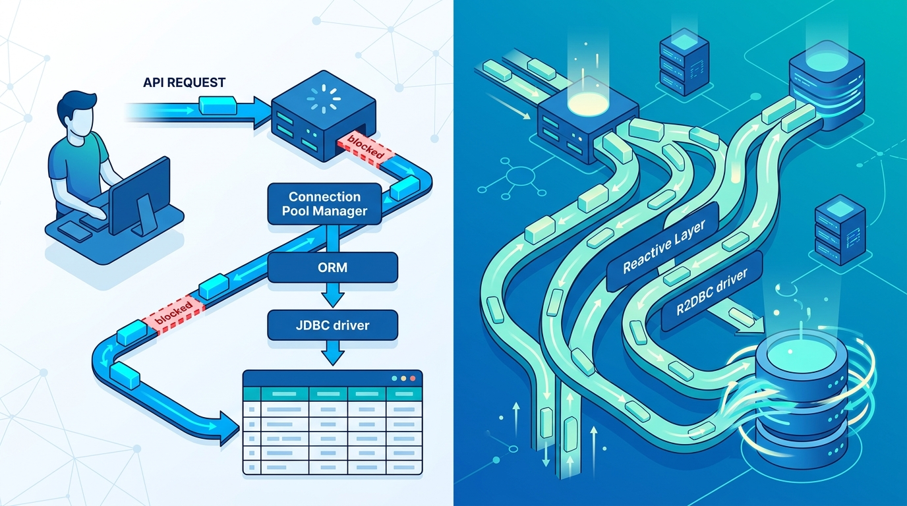
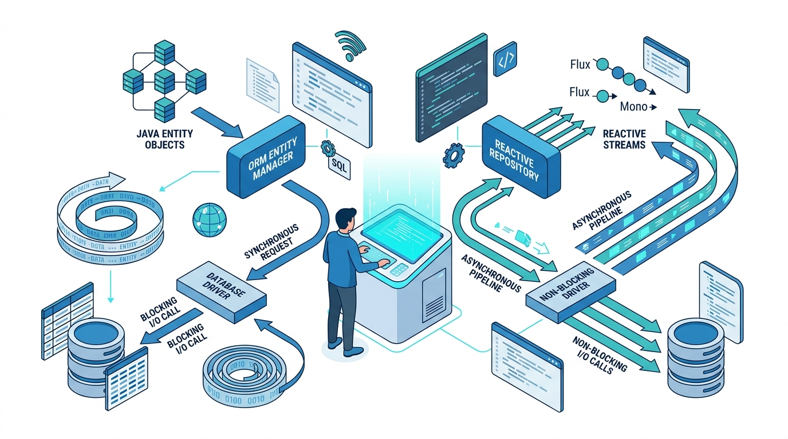

> 이 글은 **[Spring MVC vs WebFlux, 언제 무엇을 써야 할까? 차이점 쉽게 정리](/posts/spring-mvc-vs-webflux-when-to-use/)**, **[Blocking vs Non-blocking, 백엔드 개발자라면 꼭 알아야 할 차이](/posts/blocking-vs-non-blocking-in-backend/)**, **[Mono와 Flux란 무엇일까? Spring WebFlux를 이해하기 위한 핵심 개념 정리](/posts/mono-vs-flux-in-spring-webflux/)**, **[Spring Boot에서 비동기 처리는 언제 필요할까? 꼭 써야 하는 경우와 아닌 경우](/posts/when-to-use-async-processing-in-spring-boot/)** 에 이어지는 Spring 시리즈 5편입니다.

Spring Boot와 WebFlux 이야기를 하다 보면 어느 순간 꼭 나오는 질문이 있습니다.

- JPA와 R2DBC는 정확히 무엇이 다를까?
- WebFlux를 쓴다면 JPA도 같이 써도 될까?
- R2DBC가 더 최신 기술이면 무조건 갈아타야 할까?
- 일반적인 Spring Boot 서비스에서는 무엇이 더 현실적일까?

이 질문은 꽤 중요합니다. 왜냐하면 웹 계층만 WebFlux로 바꾸는 것으로 끝나는 게 아니라, **데이터 접근 방식도 blocking인지 non-blocking인지 함께 연결해서 봐야 하기 때문**입니다.

결론부터 먼저 말하면, **일반적인 Spring Boot 서비스에서는 여전히 JPA가 훨씬 현실적인 기본 선택인 경우가 많고, R2DBC는 reactive stack 전체가 필요한 상황에서 검토할 가치가 있습니다.**

이번 글에서는 JPA와 R2DBC의 차이, 각각의 장단점, 그리고 어떤 상황에서 무엇을 선택하면 좋은지 쉽게 정리해보겠습니다.

## 먼저 결론부터

시간이 없으시면 아래만 먼저 보셔도 됩니다.

- **JPA는 전통적인 blocking 기반 ORM 접근입니다.**
- **R2DBC는 non-blocking/reactive 방식의 데이터 접근을 위한 선택지입니다.**
- **일반적인 CRUD 서비스는 JPA가 더 익숙하고 생산성이 좋습니다.**
- **WebFlux와 reactive stack 전체를 가져갈 때는 R2DBC를 검토할 수 있습니다.**
- **R2DBC가 더 최신이라는 이유만으로 무조건 더 좋은 것은 아닙니다.**

## JPA란 무엇인가

JPA(Java Persistence API)는 자바 진영에서 가장 익숙한 ORM 표준입니다.

Spring Boot에서는 보통 Hibernate와 함께 사용하고, 아래 같은 장점 때문에 여전히 많이 선택됩니다.

- 풍부한 자료와 예제
- 높은 생산성
- 엔티티 중심 개발 방식
- 연관관계 매핑과 영속성 컨텍스트
- Spring Data JPA 생태계의 편의성

즉, 일반적인 Spring Boot 서비스에서는 JPA가 사실상 기본 선택처럼 느껴질 정도로 익숙한 도구입니다.

다만 JPA는 전통적으로 **blocking 방식의 JDBC 기반**과 잘 맞습니다.

## R2DBC란 무엇인가

R2DBC(Reactive Relational Database Connectivity)는 관계형 데이터베이스에 대해 **reactive/non-blocking 방식으로 접근하기 위한 API**입니다.

쉽게 말하면, JDBC가 전통적인 blocking 접근이라면 R2DBC는 reactive stack에서 더 잘 맞는 데이터 접근 방식이라고 볼 수 있습니다.

Spring WebFlux와 함께 언급되는 이유도 여기에 있습니다.

- WebFlux는 non-blocking 흐름을 지향하고
- R2DBC는 데이터 접근까지 reactive하게 연결하려는 선택지이기 때문입니다.

즉, 웹 계층만 reactive하고 DB 접근은 여전히 blocking이면 구조가 어정쩡해질 수 있습니다.

## 가장 큰 차이: ORM 중심 vs Reactive 데이터 접근

JPA와 R2DBC의 차이는 단순히 "오래된 기술 vs 새로운 기술"이 아닙니다.

핵심은 접근 방식이 다르다는 점입니다.

### JPA의 느낌

- 엔티티 중심
- ORM 친화적
- 연관관계와 영속성 컨텍스트 활용
- JDBC 기반 blocking 접근

### R2DBC의 느낌

- reactive 흐름 중심
- `Mono`, `Flux` 와 자연스럽게 연결
- non-blocking 데이터 접근
- 전통적인 JPA ORM 경험과는 꽤 다름

즉, R2DBC는 JPA를 reactive 문법으로 바꾼 버전이 아니라, **아예 다른 성격의 데이터 접근 모델**에 가깝습니다.

## WebFlux를 쓴다면 JPA도 같이 쓸 수 있을까

기술적으로는 가능하지만, 보통은 조심해서 봐야 합니다.

왜냐하면 JPA는 blocking 방식이고, WebFlux는 non-blocking 흐름을 지향하기 때문입니다.

즉,

- 웹 계층은 non-blocking인데
- DB 접근은 blocking이면
- 결국 중간에서 blocking 요소가 들어오게 됩니다.

이게 절대 불가능하다는 뜻은 아니지만, "reactive stack의 장점을 끝까지 살리고 싶다"는 관점에서는 어색한 구성이 될 수 있습니다.

그래서 reactive stack을 진지하게 가져가려는 경우에는 보통 R2DBC까지 함께 검토하게 됩니다.

## 그렇다면 왜 아직도 JPA가 더 많이 쓰일까

이유는 꽤 현실적입니다.

### 1. 생산성이 높다

일반적인 CRUD 개발에서는 JPA가 훨씬 익숙하고 빠릅니다.

### 2. 생태계가 탄탄하다

예제, 자료, 실무 경험, 라이브러리 호환성 면에서 JPA는 여전히 강합니다.

### 3. 팀이 익숙하다

새로운 기술을 도입할 때 가장 큰 비용은 기술 그 자체보다 팀 적응 비용인 경우가 많습니다.

### 4. 대부분의 서비스는 여기까지 필요하지 않다

모든 서비스가 높은 동시성과 reactive end-to-end 구조를 꼭 필요로 하지는 않습니다.

즉, "문제 해결"보다 "기술 도입"이 앞서면 JPA를 두고 굳이 R2DBC로 갈 이유가 약해집니다.

## R2DBC를 검토할 만한 경우

그렇다고 R2DBC가 의미 없다는 뜻은 아닙니다. 아래 같은 상황에서는 충분히 검토할 가치가 있습니다.

### 1. WebFlux를 중심으로 reactive stack 전체를 가져가려는 경우

웹 계층, 외부 API 호출, 데이터 접근까지 모두 reactive하게 연결하고 싶다면 R2DBC가 더 잘 맞습니다.

### 2. 높은 동시성과 I/O 효율이 중요한 경우

대기 시간이 길고 동시 요청이 많다면 non-blocking 데이터 접근의 의미가 커질 수 있습니다.

### 3. 스트리밍과 이벤트 기반 처리가 중요한 경우

결과를 순차적으로 흘려보내거나 reactive 흐름이 핵심인 구조라면 R2DBC가 자연스럽습니다.

## 실무에서 자주 하는 오해

### R2DBC가 더 최신이니까 무조건 좋다?

아닙니다. 최신이라는 이유만으로 선택할 기술은 아닙니다.

### JPA는 이제 구식이다?

전혀 아닙니다. 지금도 대부분의 Spring Boot 서비스에서 JPA는 매우 현실적인 선택입니다.

### WebFlux를 쓰면 반드시 R2DBC를 써야 한다?

절대적인 규칙은 아닙니다. 다만 reactive 장점을 끝까지 살리고 싶다면 검토 가치가 크다는 정도로 이해하는 게 좋습니다.

### R2DBC가 JPA를 완전히 대체하나?

그렇게 보기 어렵습니다. 둘은 해결하려는 문제와 잘 맞는 상황이 꽤 다릅니다.

## 실무에서 빠르게 판단하는 기준

### JPA가 더 잘 맞는 경우

- 일반적인 CRUD 서비스
- 빠른 개발 생산성이 중요함
- 팀이 JPA에 익숙함
- ORM 중심 개발이 편함
- 복잡한 reactive stack이 꼭 필요하지 않음

### R2DBC를 검토할 만한 경우

- WebFlux 중심 아키텍처를 가져가려는 경우
- end-to-end reactive 흐름이 중요함
- 높은 동시성과 I/O 효율이 중요한 경우
- 스트리밍/이벤트 기반 처리가 많음
- 팀이 reactive 개발 방식에 익숙하거나 준비되어 있음

## 한 줄 요약

**JPA는 일반적인 Spring Boot 서비스의 현실적인 기본 선택이고, R2DBC는 reactive stack 전체가 필요할 때 검토할 선택지입니다.**

중요한 건 "무엇이 더 최신인가"가 아니라, **우리 서비스와 팀이 어떤 문제를 풀고 있는가** 입니다.

## 마무리

JPA와 R2DBC는 단순히 세대교체 관계로 보기보다, 잘 맞는 문제 영역이 다른 선택지로 보는 편이 더 정확합니다.

정리하면 이렇습니다.

- **일반적인 서비스는 JPA가 더 익숙하고 생산적입니다.**
- **WebFlux와 reactive end-to-end 구조를 원하면 R2DBC를 검토할 수 있습니다.**
- **R2DBC는 JPA의 단순한 대체제가 아닙니다.**
- **기술 선택은 성능뿐 아니라 학습 비용과 운영 복잡도까지 함께 봐야 합니다.**

Spring 시리즈를 여기서 더 확장한다면 다음으로는 **WebFlux를 실무에 도입할 때 주의할 점**이나 **Reactive 코드가 복잡해질 때 피해야 할 패턴** 같은 글로 이어가는 것도 자연스럽습니다.
