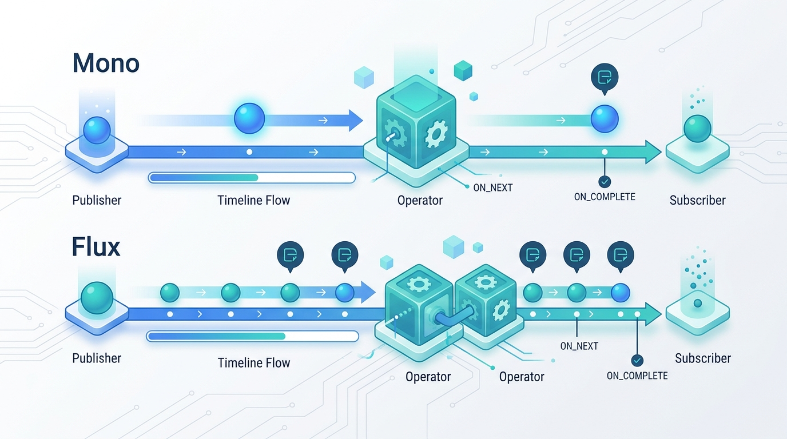

> Korean version: [Mono와 Flux란 무엇일까? Spring WebFlux를 이해하기 위한 핵심 개념 정리](/posts/mono-vs-flux-in-spring-webflux/)

> This is part 3 of the Spring/WebFlux series, after **[Spring MVC vs WebFlux](/posts/spring-mvc-vs-webflux-when-to-use-en/)** and **[Blocking vs Non-Blocking](/posts/blocking-vs-non-blocking-in-backend-en/)**. Once those ideas make sense, `Mono` and `Flux` become much easier to read in actual WebFlux code.

If you start learning Spring WebFlux, two types appear almost immediately:

- `Mono`
- `Flux`

At first, they feel unfamiliar for a simple reason: most Spring MVC code does not make you think this way.

In MVC, you are used to seeing things like:

- `User`
- `List<User>`
- `ResponseEntity<User>`

In WebFlux, you suddenly see:

- `Mono<User>`
- `Flux<User>`

That naturally raises a few questions:

- What exactly is a `Mono`?
- Is `Flux` basically just a `List`?
- When should I use one instead of the other?
- Why not just return `User` directly?

## Quick summary

The shortest useful explanation is this:

- **`Mono` represents 0 or 1 result.**
- **`Flux` represents 0 to many results.**
- **Neither is just a container type. Both represent an asynchronous data flow.**
- **In WebFlux, the return type is part of the execution model, not just part of the method signature.**
- **As a beginner, “single result = Mono, multiple results = Flux” is a perfectly good place to start.**


## What `Mono` is

A `Mono` represents **zero or one asynchronous result**.

That means:

- there may be one value
- there may be no value
- there will not be many values

Typical use cases include:

- finding one user by ID
- loading one order detail
- returning one login result
- confirming a save operation
- representing completion without a data payload

A tiny example looks like this:

```java
Mono<String> greeting = Mono.just("hello");
Mono<User> emptyUser = Mono.empty();
```

In a controller, it often looks like this:

```java
@GetMapping("/users/{id}")
public Mono<UserResponse> getUser(@PathVariable Long id) {
    return userService.findById(id)
            .map(UserResponse::from);
}
```

This does not mean “I already have a `UserResponse` in my hand.”

It means “I am returning a flow that can eventually produce one `UserResponse`.”

## What `Flux` is

A `Flux` represents **zero to many asynchronous results**.

That matters because “many” in reactive code is not just about quantity. It is also about **flow over time**.

Typical cases include:

- a list of users
- search results
- real-time notifications
- a stream of chat messages
- server-sent events

Simple example:

```java
Flux<String> names = Flux.just("kim", "lee", "park");
```

In a controller:

```java
@GetMapping("/users")
public Flux<UserResponse> getUsers() {
    return userService.findAll()
            .map(UserResponse::from);
}
```

That means multiple results may be emitted as part of one flow.

## The easiest way to remember the difference

At the beginner level, this rule works well:

- **one result -> `Mono`**
- **many results -> `Flux`**

That is not the whole story, but it is a good starting mental model.

### `Mono` feels like:

- a single result
- maybe no result
- one completion signal

### `Flux` feels like:

- multiple results
- a sequence of values
- possibly a stream that keeps producing values over time

So `Flux` is not just “reactive List.” It is closer to **a stream of values moving through time**.

## Why not just return `User` or `List<User>`?

This is probably the most common question for developers coming from Spring MVC.

In MVC, returning a plain object makes perfect sense because the method usually completes after the data has been obtained.

```java
@GetMapping("/users/{id}")
public UserResponse getUser(@PathVariable Long id) {
    return userService.findById(id);
}
```

In WebFlux, the return type also expresses **how the result is delivered**.

```java
@GetMapping("/users/{id}")
public Mono<UserResponse> getUser(@PathVariable Long id) {
    return userService.findById(id);
}
```

That is less about “the shape of the data” and more about “the shape of the flow.”

## A practical analogy

Sometimes a simple analogy helps more than a formal definition.

### `Mono` is like waiting for one package

- the package may arrive
- it may not arrive
- but you are expecting at most one package

### `Flux` is like receiving multiple deliveries over time

- one delivery may arrive now
- another may arrive later
- the sequence may end after a few items
- or it may keep going as a stream

That is why `Flux` feels different from a `List`. A list is usually already collected. A `Flux` can represent values arriving one by one.



## When `Mono` is common in real code

### 1. Single-item lookup

- one user
- one product detail
- one article

### 2. Save or update returning one result

- create one entity
- update and return one response

### 3. Completion without payload

This is where `Mono<Void>` often appears:

```java
@DeleteMapping("/users/{id}")
public Mono<Void> deleteUser(@PathVariable Long id) {
    return userService.deleteById(id);
}
```

That can feel strange at first, but the meaning is practical:

- there is no response body to return
- but the completion of the async work still matters

## When `Flux` is common in real code

### 1. List responses

- user lists
- search results
- order histories

### 2. Streaming APIs

- live logs
- notifications
- SSE endpoints

### 3. Event processing

- message streams
- queue consumption
- sensor or telemetry data feeds

So yes, `Flux` can be used for ordinary lists—but it becomes especially valuable when the result is naturally a stream.

## Common misunderstandings

### “`Flux` is just the same thing as `List`”
Not quite. A `List` is already collected data. A `Flux` can describe the process of values arriving over time.

### “`Mono` is just `Optional`”
They can feel similar at first because both can represent “maybe one value,” but `Mono` is an asynchronous reactive type, not just a wrapper around presence or absence.

### “`Flux` is always the more advanced choice”
Not really. In many business APIs, `Mono` is extremely common because single-item operations are everywhere.

## A simple beginner rule that is good enough

When you are just starting, this is enough:

- return **`Mono`** for 0 or 1 result
- return **`Flux`** for many results
- remember that both describe **reactive flow**, not just data shape

That alone makes WebFlux code much less intimidating.

## One-sentence takeaway

**`Mono` represents zero or one asynchronous result, and `Flux` represents zero to many asynchronous results flowing over time.**

If you want the beginner shortcut:

- single -> `Mono`
- multiple -> `Flux`

## Final thoughts

`Mono` and `Flux` feel unfamiliar at first because they ask you to think in terms of flow rather than just values. But once that mental shift happens, WebFlux code becomes much easier to read.

A practical summary looks like this:

- **`Mono` fits one result**
- **`Flux` fits many results or streaming results**
- **in WebFlux, return types describe the processing model**
- **the single vs multiple shortcut is good enough for early learning**

---

## Spring/WebFlux series

1. [Spring MVC vs WebFlux: When Should You Use Each?](/posts/spring-mvc-vs-webflux-when-to-use-en/)
2. [Blocking vs Non-Blocking in Backend Systems: What Actually Matters?](/posts/blocking-vs-non-blocking-in-backend-en/)
3. [Mono vs Flux in Spring WebFlux: The Core Idea in Plain English](/posts/mono-vs-flux-in-spring-webflux-en/)
4. [When Do You Actually Need Async Processing in Spring Boot?](/posts/when-to-use-async-processing-in-spring-boot-en/)
5. [JPA vs R2DBC in Spring: Which One Fits Your Application?](/posts/jpa-vs-r2dbc-in-spring-en/)
6. [WebFlux in Production: Pitfalls to Watch Before You Adopt It](/posts/webflux-production-pitfalls-en/)
