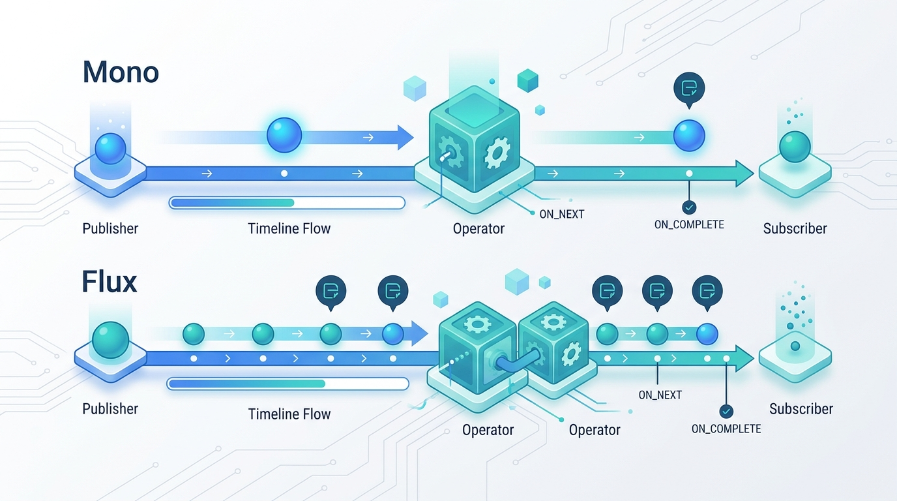

> 이 글은 **[Spring MVC vs WebFlux, 언제 무엇을 써야 할까? 차이점 쉽게 정리](/posts/spring-mvc-vs-webflux-when-to-use/)**, **[Blocking vs Non-blocking, 백엔드 개발자라면 꼭 알아야 할 차이](/posts/blocking-vs-non-blocking-in-backend/)** 에 이어지는 Spring 시리즈 3편입니다. 이번에는 WebFlux를 볼 때 가장 자주 마주치는 **Mono** 와 **Flux** 를 쉽게 정리해보겠습니다.

Spring WebFlux를 처음 공부하면 금방 마주치는 타입이 있습니다. 바로 `Mono` 와 `Flux` 입니다.

그런데 처음 보면 이름부터 조금 낯섭니다.

- `Mono`는 정확히 무엇을 의미할까?
- `Flux`는 List 같은 개념일까?
- 둘 중 언제 무엇을 써야 할까?
- 그냥 `String`이나 `User`를 반환하면 안 되는 걸까?

이 부분이 처음엔 꽤 헷갈릴 수 있습니다. 특히 Spring MVC에 익숙한 분들은 `User`, `List<User>` 같은 반환 타입은 익숙하지만, `Mono<User>`, `Flux<User>` 는 낯설게 느껴질 수밖에 없습니다.

결론부터 말하면, **Mono는 0개 또는 1개의 값을 비동기적으로 다루는 타입이고, Flux는 0개 이상의 여러 값을 흐름으로 다루는 타입**입니다.

이번 글에서는 어렵게 리액티브 이론을 깊게 파기보다, 실무에서 어떤 느낌으로 이해하면 되는지 중심으로 정리해보겠습니다.

## 먼저 결론부터

시간이 없으시면 아래 내용만 먼저 보셔도 됩니다.

- **Mono는 결과가 없거나 하나인 경우에 사용합니다.**
- **Flux는 결과가 여러 개이거나, 여러 이벤트가 흐르는 경우에 사용합니다.**
- **Mono와 Flux는 단순한 자료형이 아니라 비동기 데이터 흐름을 표현하는 타입입니다.**
- **Spring WebFlux에서는 반환 타입 자체가 처리 방식의 일부입니다.**
- **단건 조회면 Mono, 목록/스트림이면 Flux라고 먼저 이해해도 충분합니다.**


## Mono란 무엇인가

`Mono` 는 **0개 또는 1개의 결과를 비동기적으로 표현하는 Publisher**라고 이해하면 됩니다.

조금 쉽게 풀면 이렇게 생각하면 됩니다.

- 결과가 하나 있을 수도 있음
- 없을 수도 있음
- 하지만 여러 개가 오지는 않음

예를 들면 이런 경우가 Mono와 잘 맞습니다.

- 사용자 ID로 회원 1명 조회
- 로그인 결과 반환
- 주문 1건 상세 조회
- 저장 완료 후 결과 1개 반환
- 성공/실패만 전달하는 완료 신호

코드 느낌으로 보면 아래처럼 자주 등장합니다.

```java
Mono<String> greeting = Mono.just("hello");
Mono<User> emptyUser = Mono.empty();
```

`Mono.just(...)` 는 값 1개를 감싸는 가장 단순한 예시이고, `Mono.empty()` 는 결과가 없을 수 있는 흐름을 표현할 때 자주 떠올리면 좋습니다.

```java
@GetMapping("/users/{id}")
public Mono<UserResponse> getUser(@PathVariable Long id) {
    return userService.findById(id)
            .map(UserResponse::from);
}
```

이 코드는 "사용자 한 명을 비동기 흐름으로 반환한다"는 의미에 가깝습니다.

즉, 지금 당장 `UserResponse` 를 들고 있는 게 아니라, **나중에 결과가 준비되면 1개의 값을 전달할 수 있는 흐름**을 반환하는 것입니다.

## Flux란 무엇인가

`Flux` 는 **0개 이상의 여러 값을 비동기 흐름으로 표현하는 Publisher**입니다.

쉽게 말하면,

- 값이 여러 개 올 수 있고
- 시간에 따라 순서대로 흘러올 수도 있고
- 경우에 따라 끝이 있을 수도, 계속 이어질 수도 있습니다.

Flux가 잘 맞는 예시는 아래와 같습니다.

- 사용자 목록 조회
- 검색 결과 여러 건 반환
- 실시간 알림 이벤트 스트림
- 채팅 메시지 흐름
- 서버 센트 이벤트(SSE)

예를 들면,

```java
Flux<String> names = Flux.just("kim", "lee", "park");
```

또는 WebFlux API에서는 아래처럼 자주 보게 됩니다.

```java
@GetMapping("/users")
public Flux<UserResponse> getUsers() {
    return userService.findAll()
            .map(UserResponse::from);
}
```

이 코드는 여러 사용자를 하나의 흐름으로 흘려보낼 수 있다는 의미입니다.

중요한 점은 Flux를 단순히 `List`와 같은 것으로만 보면 안 된다는 것입니다. `List`는 이미 메모리에 모아둔 여러 값의 묶음에 가깝지만, `Flux`는 **값이 순서대로 전달되는 흐름**에 더 가깝습니다.

## 가장 쉬운 구분법: 하나면 Mono, 여러 개면 Flux

처음엔 아주 단순하게 외워도 괜찮습니다.

- 한 건 조회 → `Mono`
- 여러 건 조회 → `Flux`

이렇게만 이해해도 초반에는 큰 문제가 없습니다.

다만 조금 더 정확히 말하면, 단순히 개수만의 차이만은 아닙니다.

### Mono는 이런 느낌입니다

- 결과 한 건
- 성공 또는 빈 값
- 완료 신호 하나

### Flux는 이런 느낌입니다

- 결과 여러 건
- 여러 이벤트가 순서대로 전달됨
- 스트리밍 응답 가능

즉, Flux는 컬렉션이라기보다 **"흐르는 여러 값"** 을 표현하는 데 더 적합합니다.

## 왜 그냥 User나 List<User>를 쓰지 않을까

Spring MVC에 익숙한 분들이 가장 많이 묻는 부분이 이겁니다.

"어차피 사용자 한 명이면 `User` 반환하면 되는 거 아닌가?"

MVC에서는 그 말이 맞습니다. 하지만 WebFlux에서는 반환 타입이 단순한 데이터 타입이 아니라 **비동기 처리 모델을 표현하는 역할**도 합니다.

### Spring MVC의 느낌

```java
@GetMapping("/users/{id}")
public UserResponse getUser(@PathVariable Long id) {
    return userService.findById(id);
}
```

이 방식은 결과가 준비된 뒤 값을 반환하는 구조에 가깝습니다.

### WebFlux의 느낌

```java
@GetMapping("/users/{id}")
public Mono<UserResponse> getUser(@PathVariable Long id) {
    return userService.findById(id);
}
```

이건 결과를 바로 꺼내서 반환하는 것이 아니라, **결과가 준비되면 전달될 흐름**을 반환하는 쪽에 가깝습니다.

즉, Mono와 Flux는 값 자체라기보다 **값이 전달되는 방식**까지 포함한 타입입니다.

## Mono와 Flux를 비유로 이해해보면

이론보다 감각적으로 이해하면 더 쉽습니다.

### Mono는 택배 1개를 기다리는 느낌

- 주문한 물건이 도착할 수도 있고
- 품절이라 안 올 수도 있고
- 어쨌든 한 번에 하나의 결과만 기대합니다.

### Flux는 여러 택배가 순서대로 오는 느낌

- 오늘 1개, 내일 2개가 올 수도 있고
- 여러 개가 순서대로 도착할 수도 있고
- 이벤트처럼 계속 이어질 수도 있습니다.

이 비유로 보면 왜 Flux가 단순한 `List`와는 조금 다른지 감이 옵니다. 한꺼번에 박스 하나에 담긴 결과가 아니라, **흐름 속에서 순서대로 들어오는 결과**에 가깝기 때문입니다.



## 실무에서는 언제 Mono를 쓰나

보통 아래 같은 경우에 Mono가 자주 등장합니다.

### 1. 단건 조회

- 회원 1명 조회
- 상품 상세 1건 조회
- 게시글 상세 조회

### 2. 생성/수정 결과 1건 반환

- 저장 완료 후 생성된 객체 반환
- 업데이트 후 결과 반환

### 3. 성공 또는 실패만 중요한 작업

- 삭제 완료
- 처리 완료 신호
- 토큰 발급 결과

예를 들어 삭제 API라면 아래처럼 쓸 수 있습니다.

```java
@DeleteMapping("/users/{id}")
public Mono<Void> deleteUser(@PathVariable Long id) {
    return userService.deleteById(id);
}
```

여기서는 실제 데이터 대신 완료 신호 자체가 중요합니다.

`Mono<Void>` 가 처음엔 어색할 수 있는데, 이건 **"반환할 데이터는 없지만 이 작업이 비동기적으로 끝났다는 사실은 전달해야 한다"** 는 의미로 보면 이해가 쉽습니다.

즉,

- 삭제는 성공했는지
- 작업은 끝났는지
- 에러는 발생하지 않았는지

이런 완료 상태를 흐름으로 표현하는 용도라고 보면 됩니다.

## 실무에서는 언제 Flux를 쓰나

Flux는 여러 결과를 흘려보내야 할 때 잘 맞습니다.

### 1. 목록 조회

- 전체 사용자 목록
- 검색 결과 목록
- 최근 주문 목록

### 2. 스트리밍 응답

- 실시간 로그 스트림
- SSE 알림
- 채팅 메시지 수신

### 3. 이벤트 흐름 처리

- 메시지 큐 소비 결과
- 이벤트 스트림 구독
- 센서 데이터 수신

즉, Flux는 단순 목록에도 쓸 수 있지만, **시간 축을 따라 여러 값이 흘러가는 상황**에서 특히 존재감이 커집니다.

## Mono와 Flux가 헷갈리는 지점

### Flux는 그냥 List와 같은가

완전히 같지 않습니다. `List`는 이미 모여 있는 결과이고, `Flux`는 여러 값이 흐르는 과정 자체를 표현할 수 있습니다.

### Mono는 Optional과 같은가

비슷하게 느껴질 수는 있지만 같지는 않습니다. `Mono`는 비동기 흐름을 담고 있고, `Optional`은 동기적인 값 존재 여부를 표현하는 쪽에 가깝습니다.

### 무조건 Flux가 더 큰 개념인가

개수 측면에서는 그렇지만, 실무에서는 단건 결과가 훨씬 많기 때문에 Mono도 매우 자주 쓰입니다.

## 처음 공부할 때는 이렇게 외워도 충분하다

처음부터 리액티브 스트림 사양이나 Publisher 개념을 깊게 파지 않아도 괜찮습니다. 초반에는 아래처럼 이해해도 실무 감각을 잡는 데 충분합니다.

- 값 하나를 나중에 돌려준다 → `Mono`
- 값 여러 개를 흐름으로 돌려준다 → `Flux`
- 반환 타입 자체가 비동기 처리 모델이다

이 감각만 먼저 잡혀도 WebFlux 예제를 읽는 속도가 훨씬 빨라집니다.

## 실무에서 빠르게 판단하는 기준

아래처럼 정리하면 됩니다.

### Mono를 고르면 되는 경우

- 결과가 0개 또는 1개다
- 단건 조회다
- 저장/수정 후 단일 결과를 반환한다
- 완료 여부만 전달하면 된다

### Flux를 고르면 되는 경우

- 결과가 여러 개다
- 목록이나 검색 결과를 반환한다
- 여러 이벤트를 순서대로 내보내야 한다
- 스트리밍 응답이 필요하다

## Spring WebFlux를 이해할 때 중요한 포인트

Mono와 Flux는 단순히 생소한 타입 이름이 아닙니다. WebFlux에서는 이 타입들이 곧 **처리 흐름의 모델**입니다.

즉,

- 요청을 어떻게 받고
- 결과를 어떤 흐름으로 돌려주고
- 여러 값을 어떻게 연결하고 가공할지

이런 부분을 Mono와 Flux 중심으로 생각하게 됩니다.

그래서 WebFlux를 배울 때는 "문법을 외운다"보다 **"결과가 몇 개 나오고, 그 결과가 어떤 흐름으로 전달되는가"** 를 먼저 생각하는 편이 훨씬 이해가 잘 됩니다.

## 한 줄 요약

**Mono는 0개 또는 1개의 비동기 결과를 표현하고, Flux는 0개 이상의 여러 결과 흐름을 표현합니다.**

처음에는 그냥 이렇게 기억하셔도 충분합니다.

- 단건이면 `Mono`
- 여러 건이면 `Flux`

그리고 익숙해질수록, 이 둘이 단순 자료형이 아니라 **리액티브 데이터 흐름을 표현하는 핵심 타입**이라는 점이 더 중요하게 느껴질 것입니다.

## 마무리

Spring WebFlux를 처음 접하면 Mono와 Flux가 낯설게 느껴지지만, 막상 개념을 단순하게 잡고 나면 생각보다 어렵지 않습니다.

정리하면 이렇습니다.

- **Mono는 하나의 결과를 다룰 때 적합합니다.**
- **Flux는 여러 결과나 이벤트 흐름을 다룰 때 적합합니다.**
- **WebFlux에서는 반환 타입 자체가 처리 모델의 일부입니다.**
- **처음에는 단건/다건 기준으로 이해해도 충분합니다.**

다음 글에서는 여기서 한 단계 더 나아가서, **[Spring Boot에서 비동기 처리는 언제 필요하고 언제 굳이 복잡하게 가져갈 필요가 없는지](/posts/when-to-use-async-processing-in-spring-boot/)** 를 정리해보겠습니다.

---

## Spring/WebFlux 시리즈 전체 보기

1. [Spring MVC vs WebFlux, 언제 무엇을 써야 할까?](/posts/spring-mvc-vs-webflux-when-to-use/)
2. [Blocking vs Non-blocking, 백엔드 개발자라면 꼭 알아야 할 차이](/posts/blocking-vs-non-blocking-in-backend/)
3. [Mono와 Flux란 무엇일까? Spring WebFlux를 이해하기 위한 핵심 개념 정리](/posts/mono-vs-flux-in-spring-webflux/)
4. [Spring Boot에서 비동기 처리는 언제 필요할까? 꼭 써야 하는 경우와 아닌 경우](/posts/when-to-use-async-processing-in-spring-boot/)
5. [JPA와 R2DBC 차이점 정리, Spring에서 무엇을 선택해야 할까?](/posts/jpa-vs-r2dbc-in-spring/)
6. [WebFlux를 실무에 도입할 때 주의할 점, 시작 전에 꼭 봐야 할 체크포인트](/posts/webflux-production-pitfalls/)
