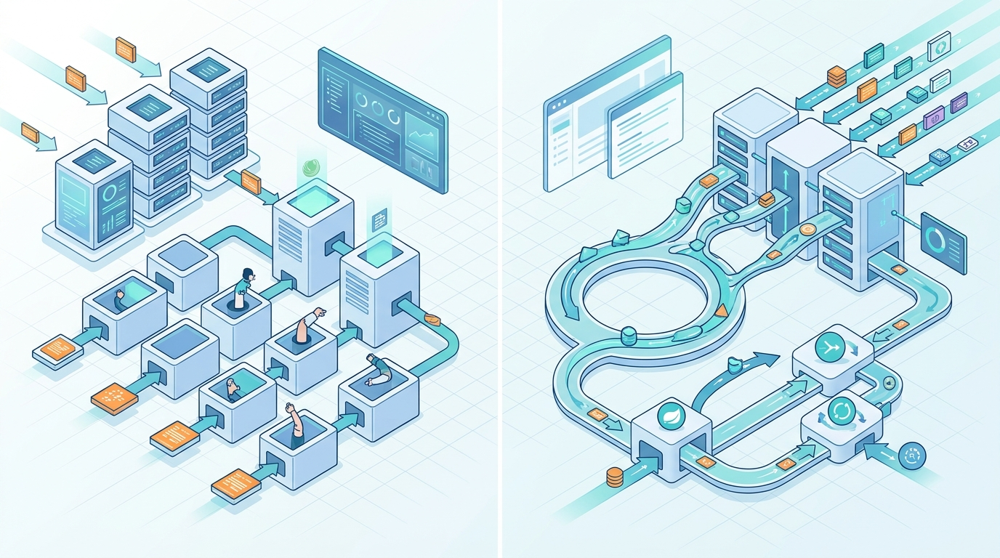
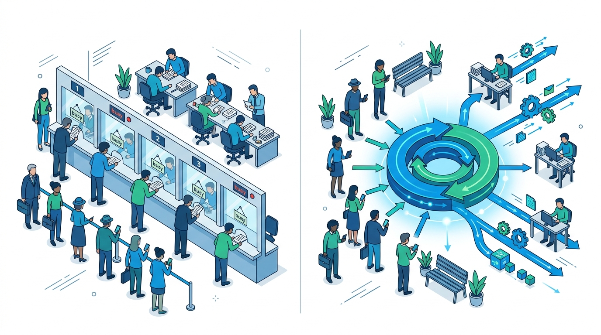
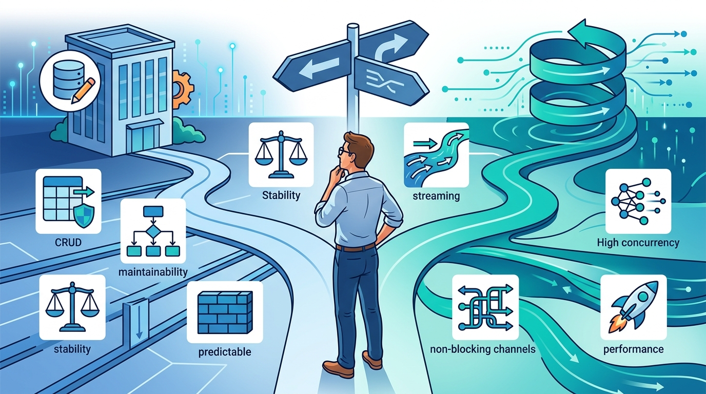

> Korean version: [Spring MVC vs WebFlux, 언제 무엇을 써야 할까? 차이점 쉽게 정리](/posts/spring-mvc-vs-webflux-when-to-use/)

> This is the opening post in the Spring/WebFlux series. If you want the full picture, the next posts on **blocking vs non-blocking**, **Mono vs Flux**, **async processing**, and **JPA vs R2DBC** connect together naturally.

If you spend enough time around Spring Boot, you eventually run into the same question:

- What is the real difference between Spring MVC and WebFlux?
- If WebFlux is newer, should I just use that?
- For a new project, which one is the safer choice?

At a glance, both look like ways to build web applications with Spring. That part is true. But the execution model, the programming style, and the kinds of problems they solve well are meaningfully different.

The short version is simple:

**For most ordinary business applications, Spring MVC is still a very good default.**

**WebFlux becomes interesting when high concurrency, streaming, or non-blocking I/O is a real requirement rather than just a buzzword.**

This post walks through that difference in plain terms.

## Quick summary

If you only need the decision points, they are these:

- **Spring MVC fits traditional request-response applications very well.**
- **WebFlux is built around a non-blocking, reactive model.**
- **WebFlux is not automatically faster in every case.**
- **Team familiarity, debugging cost, and library compatibility matter as much as raw architecture.**
- **If you are unsure, Spring MVC is usually the lower-risk starting point.**



## What Spring MVC is

Spring MVC is the classic and still most widely used Spring web stack.

The mental model is familiar:

- a client sends a request
- a controller handles it
- service and repository layers do the work
- the application returns a response

This model is popular for a reason. It is readable, well-documented, and supported by a massive ecosystem. Most examples, libraries, and production habits in the Spring world still line up naturally with it.

Under the hood, Spring MVC is based on the Servlet model. In everyday practical terms, that usually means **a request is handled by a thread that stays tied to that work while waiting for it to finish**.

So if the application is waiting on a database query or an external API call, that request-handling thread is also waiting.

That is why people call it a **blocking** model.

## What WebFlux is

Spring WebFlux arrived as Spring’s reactive web stack.

The important part is not that the syntax looks a little different. The important part is that **the processing model itself is different from MVC**.

WebFlux is built around:

- **non-blocking I/O**
- **reactive programming**
- types such as **`Mono`** and **`Flux`**

At a very simple level:

- `Mono` means 0 or 1 result
- `Flux` means multiple results or a stream of results

The idea is not to keep threads sitting around waiting longer than necessary. Instead, WebFlux is designed to handle waiting-heavy I/O more efficiently, especially when many requests or connections are active at once.

That makes it a more natural fit for things like streaming responses, SSE, WebSocket-heavy systems, or services with a lot of outbound network waiting.

## The biggest difference: blocking vs non-blocking

This is the real dividing line.

### Spring MVC is easier to understand as a blocking model

Imagine a database call takes 300 ms.

In a typical MVC mental model:

- a request gets a thread
- that thread calls the database
- it waits for the result
- then it builds and returns the response

For many applications, this is perfectly fine. It is simple and predictable.

The pain starts when:

- waiting time is long
- many requests are in flight at the same time
- thread usage grows significantly under load

### WebFlux tries to use resources more efficiently during waiting

WebFlux does not remove waiting from the universe. A remote API is still slow if it is slow.

What changes is **how the application behaves while it waits**.

Instead of holding onto a thread in the same way, it is designed so that waiting-heavy work can be handled with less waste, which can improve concurrency under the right conditions.

That said, this matters:

**non-blocking does not mean universally faster.**

If your workload is mostly straightforward CRUD and ordinary business logic, you may not feel a dramatic benefit at all.



## The coding style changes too

For many developers, the first noticeable difference is not performance. It is the coding style.

### Spring MVC example

```java
@GetMapping("/users/{id}")
public UserResponse getUser(@PathVariable Long id) {
    User user = userService.findById(id);
    return UserResponse.from(user);
}
```

This is direct and easy to read.

### WebFlux example

```java
@GetMapping("/users/{id}")
public Mono<UserResponse> getUser(@PathVariable Long id) {
    return userService.findById(id)
            .map(UserResponse::from);
}
```

At first glance, the difference seems small. But once real logic grows—error handling, combining calls, chaining async work, streaming results—the reactive style becomes a different way of thinking.

That learning curve is real.

## Is WebFlux faster?

This is where a lot of confusion comes from.

**WebFlux is not a magic “faster Spring.”**

### Cases where WebFlux can help

- very high concurrency
- lots of outbound API calls
- streaming responses
- long I/O wait times
- services where connection efficiency matters a lot

### Cases where Spring MVC is often enough, or better

- ordinary CRUD applications
- admin systems and back-office apps
- teams with little reactive experience
- projects that depend heavily on traditional libraries
- environments where maintenance simplicity matters more than architectural purity

Performance depends on the actual bottleneck. If the real problem is not I/O concurrency, WebFlux may not solve much.

## When Spring MVC is the better fit in practice

In real production work, there are plenty of cases where MVC is still the more sensible choice.

### 1. The service is mostly CRUD

User registration, login, order lookup, admin management, content editing—most of this works extremely well with MVC.

### 2. The application is centered on JPA

JPA fits naturally with the traditional blocking model. If the persistence layer is strongly JPA-oriented, MVC usually feels more coherent.

### 3. Team familiarity matters

A technically elegant stack can still be the wrong stack if the team struggles to maintain it.

### 4. Operational simplicity matters

Reactive flows can be perfectly manageable once a team is comfortable with them, but they usually ask more from debugging, tracing, and incident response.

## When WebFlux makes more sense

WebFlux is worth serious consideration when the architecture truly benefits from it.

### 1. Very high connection counts

Chat systems, notification streams, SSE, and WebSocket-heavy workloads are common examples.

### 2. Heavy outbound I/O

If the service spends more time waiting on other services than computing locally, a non-blocking model can be more attractive.

### 3. Streaming responses

If the result itself is a stream rather than a single completed payload, WebFlux often feels more natural.

### 4. You are intentionally designing a reactive stack end to end

That means not only the web layer, but also data access, messaging, and operational habits are aligned with reactive patterns.

## Common misunderstandings

### “WebFlux is newer, so it must be better”
No. Newer only means newer.

### “If I use WebFlux, my server will automatically become faster”
No. It depends on the workload and the bottleneck.

### “Spring MVC is old-fashioned now”
Not at all. It is still the default production choice for many Spring teams.

### “Can I mix both in one project?”
Some combinations are technically possible, but unless there is a strong reason, keeping one clear model is usually easier to operate.

## A practical decision checklist

### Lean toward Spring MVC if:

- most features are CRUD-oriented
- you want to keep using JPA and familiar libraries
- the team is not comfortable with reactive programming yet
- maintainability and debugging simplicity matter a lot
- you want the safer default

### Investigate WebFlux if:

- streaming is a core requirement
- outbound I/O waiting dominates request time
- you need to handle many concurrent connections efficiently
- the team is ready for reactive code and reactive operations
- you are intentionally building a reactive stack, not just experimenting with one controller



## One-sentence takeaway

**For most applications, starting with Spring MVC is still a sound choice. Reach for WebFlux when the workload clearly benefits from non-blocking concurrency or streaming.**

## Final thoughts

Spring MVC and WebFlux are not old vs new. They are different models with different trade-offs.

A practical summary looks like this:

- **Spring MVC is the general-purpose default.**
- **WebFlux is powerful when the problem actually calls for it.**
- **Choosing WebFlux just because it sounds modern is usually a mistake.**
- **The right decision depends on workload, team experience, and operational reality.**

If there is no strong reason to do otherwise, Spring MVC remains a very reasonable place to begin.

---

## Spring/WebFlux series

1. [Spring MVC vs WebFlux: When Should You Use Each?](/posts/spring-mvc-vs-webflux-when-to-use-en/)
2. [Blocking vs Non-Blocking in Backend Systems: What Actually Matters?](/posts/blocking-vs-non-blocking-in-backend-en/)
3. [Mono vs Flux in Spring WebFlux: The Core Idea in Plain English](/posts/mono-vs-flux-in-spring-webflux-en/)
4. [When Do You Actually Need Async Processing in Spring Boot?](/posts/when-to-use-async-processing-in-spring-boot-en/)
5. [JPA vs R2DBC in Spring: Which One Fits Your Application?](/posts/jpa-vs-r2dbc-in-spring-en/)
6. [WebFlux in Production: Pitfalls to Watch Before You Adopt It](/posts/webflux-production-pitfalls-en/)
