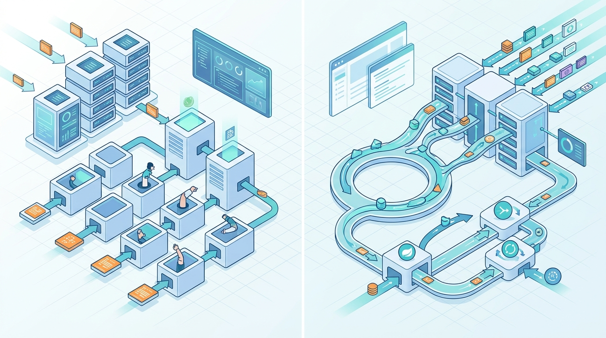
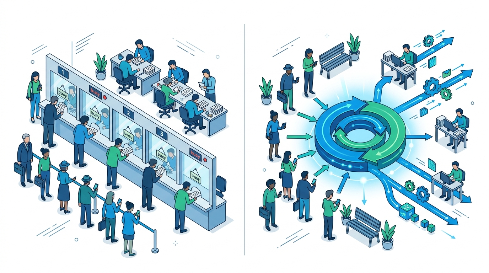
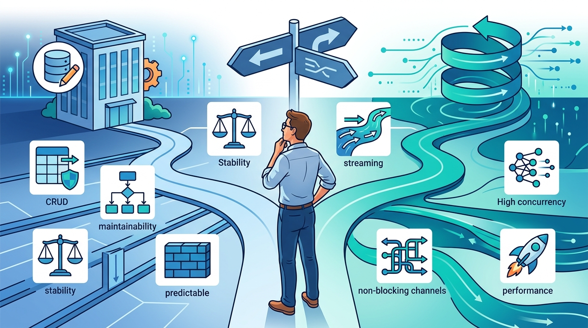

> 이 글은 Spring 시리즈의 첫 비교 글입니다. 이어서 **Blocking vs Non-blocking**, **Mono와 Flux**, **JPA와 R2DBC** 같은 주제로 확장해서 읽으면 흐름을 잡기 더 쉽습니다.

Spring Boot를 공부하다 보면 한 번쯤 이런 고민을 하게 됩니다.

- Spring MVC와 WebFlux는 정확히 뭐가 다를까?
- WebFlux가 더 최신 기술이면 무조건 더 좋은 걸까?
- 새 프로젝트를 시작할 때 무엇을 선택해야 할까?

이 질문은 생각보다 중요합니다. 이름만 보면 둘 다 결국 웹 애플리케이션을 만드는 방식처럼 보이지만, 내부 동작 방식과 잘 맞는 사용 시나리오는 꽤 다릅니다.

결론부터 먼저 말하면, **대부분의 일반적인 웹 서비스는 Spring MVC만으로도 충분한 경우가 많습니다.** 반면 **동시 연결이 많고, 스트리밍이나 논블로킹 I/O의 장점이 중요한 상황이라면 WebFlux가 더 잘 맞을 수 있습니다.**

이번 글에서는 Spring MVC와 WebFlux의 차이점을 어렵지 않게 정리하고, 실제로 어떤 기준으로 선택하면 좋은지도 함께 정리해보겠습니다.

## 먼저 결론부터

시간이 없는 분들을 위해 핵심만 먼저 정리하면 이렇습니다.

- **Spring MVC는 전통적인 request-response 구조에 익숙하고, 일반적인 CRUD 서비스에 잘 맞습니다.**
- **WebFlux는 non-blocking 기반으로 동작하며, 높은 동시성이나 스트리밍 처리에 유리할 수 있습니다.**
- **WebFlux가 무조건 더 빠르거나 더 좋은 것은 아닙니다.**
- **팀의 학습 비용, 운영 난이도, 기존 라이브러리 호환성까지 같이 보고 선택해야 합니다.**
- **잘 모르겠다면 기본 선택은 Spring MVC가 더 안전한 경우가 많습니다.**

이제 왜 이런 결론이 나오는지 차근차근 보겠습니다.



## Spring MVC란 무엇인가

Spring MVC는 가장 널리 알려진 Spring의 웹 애플리케이션 개발 방식입니다.

보통 우리가 흔히 보는 구조는 아래와 같습니다.

- 클라이언트가 요청을 보냄
- Controller가 요청을 받음
- Service와 Repository를 거쳐 데이터를 처리함
- 결과를 다시 응답으로 반환함

이 방식은 이해하기 쉽고, 자료도 많고, 대부분의 라이브러리와 예제가 잘 맞습니다. 그래서 실무에서도 여전히 가장 많이 사용되는 편입니다.

Spring MVC는 기본적으로 **Servlet API 기반**에서 동작하고, 전통적으로는 **요청을 처리하는 동안 스레드가 해당 작업에 묶이는 방식**으로 이해하면 쉽습니다.

즉, 데이터베이스 조회나 외부 API 호출처럼 시간이 걸리는 작업이 있으면 그동안 해당 요청을 처리하는 스레드는 기다리게 됩니다.

이게 바로 많은 분들이 말하는 **blocking 방식**입니다.

## WebFlux란 무엇인가

WebFlux는 Spring 5부터 등장한 **reactive web stack**입니다.

핵심은 단순히 문법이 다르다는 게 아니라, **처리 방식 자체가 Spring MVC와 다르다**는 점입니다.

WebFlux는 **non-blocking**과 **reactive programming**을 기반으로 합니다. 코드에서는 보통 `Mono`와 `Flux` 같은 타입을 사용하게 됩니다.

아주 단순하게 보면 이렇게 이해하면 됩니다.

- `Mono`: 결과가 0개 또는 1개
- `Flux`: 결과가 여러 개

WebFlux는 요청을 처리하는 동안 스레드를 오래 붙잡아두지 않고, 대기 시간이 있는 작업을 더 효율적으로 다루는 방향에 초점이 있습니다.

그래서 네트워크 호출이 많거나, 스트리밍 응답을 처리하거나, 많은 연결을 효율적으로 관리해야 하는 상황에서 자주 언급됩니다.

## 가장 큰 차이: Blocking vs Non-blocking

Spring MVC와 WebFlux의 차이를 설명할 때 가장 많이 나오는 키워드는 바로 **blocking**과 **non-blocking**입니다.

### Spring MVC는 보통 blocking 방식으로 이해하면 쉽다

예를 들어 데이터베이스에서 값을 조회하는 동안 300ms가 걸린다고 가정해보겠습니다.

Spring MVC에서는 그 요청을 처리하는 스레드가 그 시간 동안 결과를 기다리는 구조로 이해할 수 있습니다.

즉,

- 요청 1개당 처리 스레드가 연결되고
- 외부 작업이 끝날 때까지 기다리고
- 결과를 받아 응답을 반환합니다.

일반적인 트래픽에서는 이 구조가 단순하고 안정적입니다. 문제는 대기 시간이 긴 작업이 많고 동시에 들어오는 요청 수가 매우 많아질 때입니다.

### WebFlux는 기다리는 동안 자원을 더 효율적으로 쓰려는 방향이다

WebFlux는 외부 작업이 끝날 때까지 스레드를 계속 붙잡아두기보다, 다른 작업을 처리할 수 있게 설계된 방식에 가깝습니다.

그래서 I/O 대기가 긴 상황에서는 더 적은 자원으로 높은 동시성을 처리하는 데 장점이 있을 수 있습니다.

다만 여기서 중요한 점이 있습니다.

**non-blocking 구조를 쓴다고 해서 모든 상황에서 무조건 성능이 좋아지는 것은 아닙니다.**

CPU 계산이 많은 작업이나 일반적인 CRUD 위주의 서비스에서는 체감 이점이 크지 않을 수도 있습니다.



## 코드 스타일도 꽤 다르다

실제로 개발자가 가장 먼저 체감하는 차이는 성능보다 **코드 작성 방식**일 때가 많습니다.

### Spring MVC 예시

```java
@GetMapping("/users/{id}")
public UserResponse getUser(@PathVariable Long id) {
    User user = userService.findById(id);
    return UserResponse.from(user);
}
```

읽기 쉽고 직관적입니다. 대부분의 개발자가 처음 접하기에도 부담이 적습니다.

### WebFlux 예시

```java
@GetMapping("/users/{id}")
public Mono<UserResponse> getUser(@PathVariable Long id) {
    return userService.findById(id)
            .map(UserResponse::from);
}
```

겉으로 보면 큰 차이가 없어 보일 수 있지만, 실제 로직이 복잡해질수록 흐름이 달라집니다. 에러 처리, 조합, 스트림 변환, 비동기 흐름 연결 같은 부분에서 reactive 스타일에 익숙하지 않으면 난이도가 올라갈 수 있습니다.

즉, WebFlux는 단순히 새로운 문법이 아니라 **생각하는 방식 자체가 달라지는 기술**에 가깝습니다.

## WebFlux가 더 빠른가?

많이 나오는 오해 중 하나가 바로 이것입니다.

**WebFlux = 무조건 더 빠름**

하지만 이건 반쯤만 맞는 말입니다.

### WebFlux가 유리할 수 있는 경우

- 동시에 연결되는 요청 수가 많을 때
- 외부 API 호출이 많을 때
- 스트리밍 처리가 필요할 때
- 대기 시간이 긴 I/O 작업이 많을 때
- 서버 자원을 더 효율적으로 써야 할 때

이런 경우에는 WebFlux의 장점이 살아날 수 있습니다.

### Spring MVC가 충분하거나 더 나은 경우

- 일반적인 게시판, 관리자 페이지, 쇼핑몰 백오피스
- CRUD 중심 서비스
- 팀이 reactive 경험이 많지 않을 때
- 기존 라이브러리와의 호환성이 중요할 때
- 빠른 개발과 유지보수가 더 중요할 때

즉, 성능이라는 것도 **어떤 문제를 푸느냐에 따라 달라집니다.**

사용자 수가 아주 많지 않고 일반적인 비즈니스 로직이 대부분이라면 Spring MVC가 더 단순하고 현실적인 선택일 수 있습니다.

## 실무에서 MVC가 더 잘 맞는 경우

실무에서는 생각보다 WebFlux를 꼭 써야 하는 상황이 많지 않습니다.

아래 같은 경우라면 Spring MVC가 더 무난한 선택일 가능성이 큽니다.

### 1. 대부분이 CRUD 중심 서비스일 때

회원가입, 로그인, 게시글 작성, 주문 조회처럼 전형적인 업무 시스템이라면 MVC로도 충분한 경우가 많습니다.

### 2. JPA를 중심으로 쓰고 있을 때

JPA 자체가 전통적인 blocking 접근과 잘 맞는 편이라, MVC 구조가 더 자연스럽습니다.

물론 WebFlux와 함께 아예 reactive stack으로 가려면 R2DBC 같은 다른 접근도 고려해야 하는데, 이 경우 구조와 학습 비용이 함께 올라갑니다.

### 3. 팀 전체가 익숙한 방식이 중요할 때

아무리 기술적으로 좋아 보여도 팀이 낯선 구조를 이해하지 못하면 유지보수 비용이 커집니다. 실무에서는 이 비용이 꽤 큽니다.

### 4. 디버깅과 운영 단순성이 중요할 때

Reactive 체인은 익숙해지기 전까지 흐름 추적이 더 어렵게 느껴질 수 있습니다. 장애 대응이 중요한 서비스라면 이 점도 무시하기 어렵습니다.

## WebFlux가 더 잘 맞는 경우

반대로 아래 같은 상황이라면 WebFlux를 진지하게 고려할 수 있습니다.

### 1. 동시 연결 수가 매우 많은 서비스

채팅, 알림, 실시간 피드, SSE, 웹소켓 기반 시스템처럼 많은 연결을 효율적으로 처리해야 하는 경우입니다.

### 2. 외부 I/O 호출 비중이 높은 서비스

내부 계산보다 외부 API나 다른 서비스 호출이 훨씬 많은 구조라면, non-blocking 방식의 장점이 살아날 수 있습니다.

### 3. 스트리밍 응답이 필요한 경우

데이터를 한 번에 모아 응답하는 것이 아니라, 흐름 자체를 계속 전달해야 하는 경우 WebFlux가 더 자연스럽습니다.

### 4. 처음부터 reactive stack으로 설계하려는 경우

데이터 접근, 메시징, API 처리까지 전체를 reactive하게 가져가려는 구조라면 WebFlux가 맞을 수 있습니다. 다만 이건 부분 도입보다 전체 설계 관점에서 접근해야 합니다.

## 가장 많이 헷갈리는 포인트

### WebFlux는 최신 기술이니까 무조건 좋다?

아닙니다. 최신이라는 이유만으로 선택하면 오히려 유지보수 난이도만 올라갈 수 있습니다.

### WebFlux를 쓰면 서버가 무조건 빨라진다?

그렇지 않습니다. 서비스 특성과 병목 지점에 따라 다릅니다.

### Spring MVC는 이제 구식인가?

전혀 아닙니다. 지금도 많은 서비스가 Spring MVC로 안정적으로 운영되고 있습니다.

### 둘을 한 프로젝트에서 같이 쓸 수 있나?

기술적으로는 일부 가능하지만, 보통은 명확한 이유가 없는 한 한 가지 모델을 중심으로 가져가는 편이 운영에 더 낫습니다.

## 어떤 기준으로 선택하면 좋을까

실무에서 단순하게 판단하려면 아래 기준으로 보면 됩니다.

### Spring MVC를 선택하면 좋은 경우

- 일반적인 웹 애플리케이션
- 빠른 개발 생산성이 중요함
- JPA와 익숙한 생태계를 활용하고 싶음
- 팀이 reactive 경험이 많지 않음
- 유지보수 단순성이 더 중요함

### WebFlux를 선택하면 좋은 경우

- 높은 동시성과 I/O 효율이 중요함
- 스트리밍 처리 요구가 있음
- reactive stack 전체를 이해하고 설계할 준비가 되어 있음
- 성능 실험과 운영 복잡도를 감수할 수 있음



## 실무에서 빠르게 판단하는 체크리스트

아래 질문에 답해보면 조금 더 쉽게 방향을 잡을 수 있습니다.

### Spring MVC 쪽으로 기울 가능성이 큰 경우

- 대부분의 기능이 CRUD 중심인가?
- JPA와 익숙한 생태계를 그대로 활용할 계획인가?
- 팀이 reactive 프로그래밍에 익숙하지 않은가?
- 유지보수 단순성과 디버깅 편의성이 중요한가?
- 높은 동시성보다 개발 속도와 안정성이 더 중요한가?

이 질문에 대부분 **예**라면 Spring MVC가 더 현실적인 선택일 가능성이 큽니다.

### WebFlux 쪽으로 검토할 가치가 큰 경우

- SSE, WebSocket, 실시간 스트리밍 같은 요구가 있는가?
- 외부 API 호출이나 네트워크 I/O 비중이 매우 높은가?
- 많은 동시 연결을 자원 효율적으로 처리해야 하는가?
- 팀이 reactive 흐름과 운영 복잡도를 감당할 준비가 되어 있는가?
- 처음부터 reactive stack 전체를 염두에 두고 설계하고 있는가?

이 질문에 대부분 **예**라면 WebFlux를 검토할 이유가 분명해집니다.

## 한 줄로 정리하면

**대부분의 서비스는 Spring MVC로 시작해도 충분합니다.**

그리고 아래 조건이 분명할 때 WebFlux를 고려하면 됩니다.

- blocking 구조의 한계가 실제로 문제로 드러났을 때
- 높은 동시성과 스트리밍 처리가 핵심 요구일 때
- 팀이 reactive 개발 방식에 익숙하거나 도입할 준비가 되어 있을 때

즉, 선택 기준은 "무엇이 더 최신인가"가 아니라 **"우리 서비스 문제에 무엇이 더 잘 맞는가"** 입니다.

## 마무리

Spring MVC와 WebFlux는 단순히 구버전과 신버전의 관계가 아닙니다. 두 기술은 웹 애플리케이션을 만드는 방식이 다르고, 잘 맞는 상황도 다릅니다.

정리하면 이렇습니다.

- **Spring MVC는 범용적이고 안정적인 기본 선택**입니다.
- **WebFlux는 특정 문제를 풀 때 강력한 선택지**가 될 수 있습니다.
- **최신 기술이라는 이유만으로 WebFlux를 선택할 필요는 없습니다.**
- **실무에서는 팀 역량과 운영 난이도까지 함께 봐야 합니다.**

개인적으로는 특별한 이유가 없다면 Spring MVC로 시작하고, 실제 병목과 요구사항이 분명할 때 WebFlux를 검토하는 접근이 더 현실적이라고 봅니다.

## 함께 읽으면 좋은 다음 글

이 글을 시리즈로 확장한다면 아래 순서가 자연스럽습니다.

1. **[Blocking과 Non-blocking 차이 쉽게 이해하기](/posts/blocking-vs-non-blocking-in-backend/)**
2. **[Mono와 Flux란 무엇일까? Spring WebFlux를 이해하기 위한 핵심 개념 정리](/posts/mono-vs-flux-in-spring-webflux/)**
3. **[Spring Boot에서 비동기 처리는 언제 필요할까? 꼭 써야 하는 경우와 아닌 경우](/posts/when-to-use-async-processing-in-spring-boot/)**
4. **[JPA와 R2DBC 차이점 정리, Spring에서 무엇을 선택해야 할까?](/posts/jpa-vs-r2dbc-in-spring/)**
5. **WebFlux를 실무에 도입할 때 주의할 점**

이런 식으로 이어가면 단일 글보다 훨씬 강한 내부 링크 구조를 만들 수 있고, Spring 입문자부터 실무자까지 단계적으로 끌어올 수 있습니다.

이번 글은 그 시리즈의 출발점으로 두기에 좋은 주제입니다.
