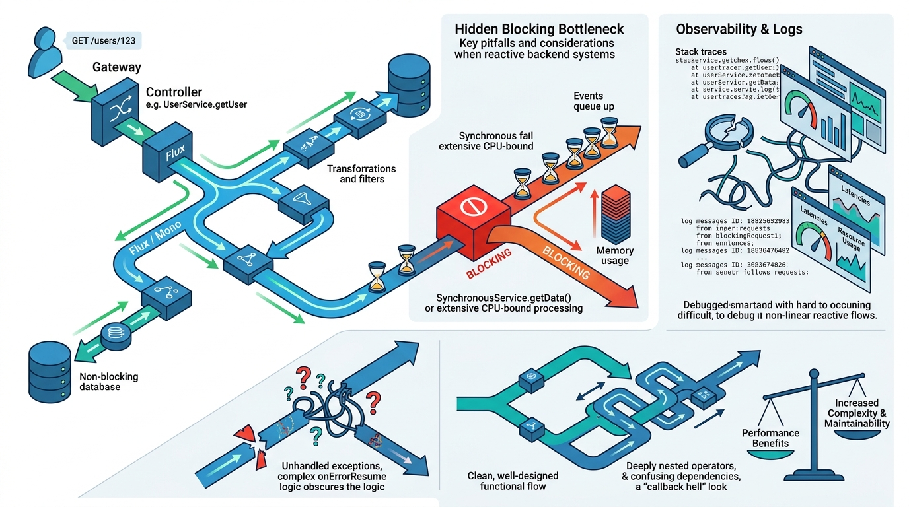

> Korean version: [WebFlux를 실무에 도입할 때 주의할 점, 시작 전에 꼭 봐야 할 체크포인트](/posts/webflux-production-pitfalls/)

> This is the final post in the Spring/WebFlux series. The earlier posts explained the concepts. This one focuses on the uncomfortable but important question: even if WebFlux is technically appealing, what tends to go wrong in real production use?

Once WebFlux starts looking interesting, the same questions come up quickly:

- If it has real strengths, why not just adopt it for new services?
- Where do teams struggle after the initial enthusiasm?
- What usually hurts more in production: the code, the debugging, or the operations?
- How much of the decision is technical, and how much is team readiness?

These questions matter because WebFlux is not just a framework feature. It changes the development model, the debugging model, and sometimes the operational model too.

**WebFlux can be a strong choice for the right problem. But if the problem is vague or the team is unprepared, it can easily add more complexity than it removes.**

## Quick summary

The practical warnings are these:

- **WebFlux is not the default best choice for every Spring Boot service.**
- **Hidden blocking can erase much of the benefit.**
- **Debugging and error tracing can feel harder than in MVC.**
- **Observability and operational discipline matter more than many teams expect.**
- **If the team is not comfortable with reactive flow, maintenance cost can rise quickly.**

## 1. WebFlux is not a default upgrade path

This is the first thing worth stating clearly.

WebFlux is not “Spring MVC, but better.”

It is better understood as a specialized option for workloads where:

- high concurrency matters
- waiting-heavy I/O matters
- streaming matters
- non-blocking behavior is part of the actual requirement

If the application is a conventional CRUD service, admin tool, or internal business system, MVC is often still the simpler and more robust choice.

So the first production pitfall is simply this:

**adopting WebFlux because it sounds modern is not a serious architectural reason.**

## 2. Hidden blocking is the biggest trap

This is probably the most common source of disappointment.

A service can look reactive at the controller layer and still contain blocking behavior in the parts that matter.

Typical examples:

- blocking JPA or JDBC calls
- blocking third-party libraries
- file handling done in a blocking way
- outbound calls that are not truly non-blocking
- careless use of `block()` inside the application

When this happens, the architecture becomes awkward:

- the surface looks reactive
- the internals still wait in blocking ways
- the operational benefit becomes weaker than expected

That does not mean every mixed design is invalid. But it does mean you should not assume “using WebFlux” automatically means “running a non-blocking system.”

## 3. Debugging can become noticeably harder

In Spring MVC, the request flow is usually easy to follow:

- request enters
- controller method runs
- service calls happen
- response is returned

With reactive chains, the flow can be less visually obvious.

That is not because reactive code is bad. It is because:

- work may be chained through multiple operators
- execution timing can be less intuitive at first
- error signals may surface differently than in direct method-call flow
- logs alone may not tell the whole story without better context propagation

For teams new to reactive programming, debugging pain is often felt earlier than performance benefit.

## 4. Error handling needs more deliberate design

Reactive code often looks elegant while everything is succeeding. Production reality appears when timeouts, partial failures, retries, and fallbacks enter the picture.

Then questions show up fast:

- where should retries happen?
- where should timeouts be enforced?
- what should happen on downstream partial failure?
- how do you avoid silent degradation or noisy retry storms?

This is where WebFlux stops being “interesting code style” and becomes an operational engineering problem.

If those concerns are not designed intentionally, the application can become hard to reason about under real failure conditions.

## 5. Observability matters more than many teams expect

A reactive system without good observability becomes frustrating quickly.

In production, you usually need to answer questions like:

- where did the request spend time?
- which downstream dependency is slow?
- where did the error originate?
- which operator or stage retried?
- what happened before the timeout?

Without strong logging, metrics, tracing, and context propagation, these questions are harder to answer.

So WebFlux is not just about writing reactive endpoints. It also pushes teams toward better operational visibility.

In practice, that means observability is not optional polish. It is part of the architecture.

## 6. Team familiarity is a real production concern

A framework choice is not just about what one senior engineer understands.

It is about what the team can maintain together.

If the team is not comfortable with:

- `Mono` and `Flux`
- reactive composition
- hidden blocking detection
- timeout and retry strategy
- debugging async flow in incidents

then the cost shows up later in maintenance and operational response.

That is why WebFlux adoption should be judged partly by team readiness, not just benchmark curiosity.

## 7. Partial adoption is often safer than all-or-nothing adoption

A very common mistake is thinking the choice must be total.

In reality, many teams get better results by introducing WebFlux only where it is clearly useful.

Examples:

- a streaming API built separately from the rest of the CRUD system
- a high-I/O gateway service using reactive patterns
- a new service designed around SSE or WebSocket workloads
- keeping the main monolith on MVC while using WebFlux in selected new components

That kind of limited adoption can preserve the benefit while reducing the blast radius.

## 8. Performance expectations should be measured, not imagined

Another production pitfall is expectation mismatch.

People sometimes adopt WebFlux with a vague assumption that performance will automatically improve.

But the real questions are:

- is the workload actually I/O-bound?
- is concurrency the real pressure point?
- is the current MVC stack already struggling?
- are downstream dependencies the real bottleneck anyway?

If none of those are true, then WebFlux may not move the needle much.

That is why serious adoption decisions should come from measurement, not architectural mood.

## A pre-adoption checklist

Before adopting WebFlux in a production service, it helps to answer these honestly:

- do we have a real high-concurrency or streaming requirement?
- is I/O wait a measurable bottleneck today?
- can we identify and manage hidden blocking across the stack?
- do we have observability good enough to debug reactive flow?
- is the team ready to maintain reactive code during incidents?
- are timeout, retry, and error-handling strategies already part of the design?

If several of these answers are still “not really,” that usually means the architecture is not ready yet—even if the code can compile.

## One-sentence takeaway

**WebFlux is not a universal performance upgrade. It is a specialized tool that pays off when concurrency-heavy, I/O-heavy, or streaming workloads justify the added complexity.**

## Final thoughts

WebFlux is genuinely valuable in the right place. The mistake is not using it. The mistake is using it without a clear problem, a prepared team, or an operational plan.

A practical summary looks like this:

- **WebFlux is strong when the workload really matches it**
- **hidden blocking is the easiest way to lose the benefit**
- **debugging and observability become more important, not less**
- **team readiness is part of architecture**
- **partial adoption is often the most realistic path**

If you made it through the full series, you now have the main conceptual path in one place: MVC vs WebFlux, blocking vs non-blocking, Mono vs Flux, async processing, JPA vs R2DBC, and finally the production trade-offs that tie them together.

---

## Spring/WebFlux series

1. [Spring MVC vs WebFlux: When Should You Use Each?](/posts/spring-mvc-vs-webflux-when-to-use-en/)
2. [Blocking vs Non-Blocking in Backend Systems: What Actually Matters?](/posts/blocking-vs-non-blocking-in-backend-en/)
3. [Mono vs Flux in Spring WebFlux: The Core Idea in Plain English](/posts/mono-vs-flux-in-spring-webflux-en/)
4. [When Do You Actually Need Async Processing in Spring Boot?](/posts/when-to-use-async-processing-in-spring-boot-en/)
5. [JPA vs R2DBC in Spring: Which One Fits Your Application?](/posts/jpa-vs-r2dbc-in-spring-en/)
6. [WebFlux in Production: Pitfalls to Watch Before You Adopt It](/posts/webflux-production-pitfalls-en/)
