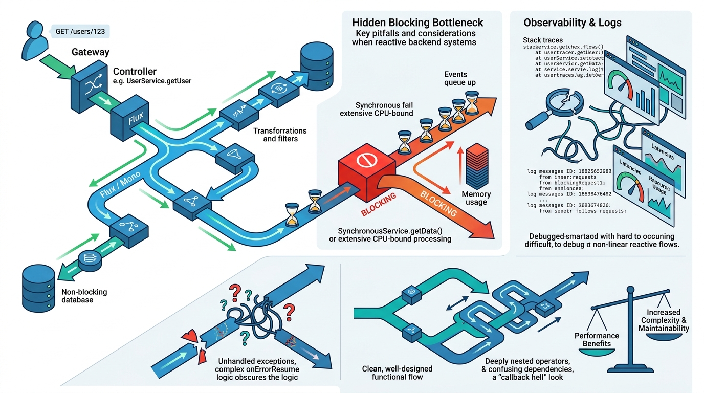

> 이 글은 **[Spring MVC vs WebFlux, 언제 무엇을 써야 할까? 차이점 쉽게 정리](/posts/spring-mvc-vs-webflux-when-to-use/)** 부터 이어진 Spring/WebFlux 시리즈의 마지막 글입니다.

Spring WebFlux를 공부하다 보면 어느 시점에는 꼭 이런 생각이 듭니다.

- WebFlux가 좋아 보이는데, 실무에서도 바로 도입해도 될까?
- 성능 장점이 있다면 그냥 새 프로젝트부터 WebFlux로 가는 게 맞을까?
- 실제로 도입하면 어디서 가장 많이 막힐까?
- 기술보다 팀과 운영 관점에서 봐야 할 건 무엇일까?

이 질문은 꽤 중요합니다. WebFlux는 분명 매력적인 기술이지만, 실무에서는 단순히 "최신 기술이라서" 또는 "성능이 좋아 보이니까" 같은 이유만으로 도입하기엔 고려할 점이 많습니다.

결론부터 말하면, **WebFlux는 특정 문제를 풀 때 강력하지만, 문제와 팀 준비가 맞지 않으면 오히려 복잡도와 운영 부담만 커질 수 있습니다.**

이번 글에서는 Spring WebFlux를 실무에 도입할 때 특히 주의해야 할 포인트를 정리해보겠습니다.

## 먼저 결론부터

시간이 없으시면 아래 내용만 먼저 보셔도 됩니다.

- **WebFlux는 모든 Spring Boot 서비스의 기본 선택은 아닙니다.**
- **hidden blocking 호출이 있으면 reactive 장점이 크게 줄어듭니다.**
- **디버깅, 예외 처리, 모니터링 방식이 기존 MVC보다 낯설 수 있습니다.**
- **팀이 reactive 흐름에 익숙하지 않다면 유지보수 비용이 크게 올라갈 수 있습니다.**
- **문제가 분명할 때 도입해야 하고, 도입 후 운영 전략까지 같이 준비해야 합니다.**

## 1. WebFlux는 기본 선택이 아니라 문제 해결용 선택지에 가깝다

이 점이 가장 중요합니다.

WebFlux는 분명 강력하지만, 일반적인 CRUD 서비스에서 무조건 더 좋은 기본값은 아닙니다.

실무에서는 아래처럼 판단하는 편이 더 현실적입니다.

- 일반적인 업무 시스템, 관리자 페이지, 백오피스 → MVC가 더 단순하고 안정적일 수 있음
- 높은 동시성, 스트리밍, 긴 I/O 대기 → WebFlux를 검토할 이유가 있음

즉, WebFlux는 "좋은 기술"이라기보다 **특정 상황에서 잘 맞는 기술**로 보는 편이 맞습니다.

## 2. 가장 큰 함정은 hidden blocking이다

WebFlux를 도입해도 내부에서 여전히 blocking 호출이 많다면 reactive 장점이 생각보다 잘 나오지 않을 수 있습니다.

예를 들면 이런 경우입니다.

- JPA/JDBC 중심 데이터 접근
- blocking 외부 라이브러리 사용
- 파일 처리나 네트워크 호출을 무심코 동기 방식으로 사용
- 내부 코드에서 `block()` 같은 호출을 남발하는 경우

이런 요소가 섞이면 겉으로는 WebFlux 애플리케이션인데, 실제로는 중간중간 blocking 병목이 남아 있게 됩니다.

그래서 WebFlux를 도입할 때는 웹 계층만이 아니라, **전체 요청 흐름에서 어디가 blocking인지** 같이 봐야 합니다.

## 3. 디버깅 방식이 익숙하지 않을 수 있다

Spring MVC는 요청이 들어와서 메서드를 타고 내려가는 흐름이 비교적 직관적입니다. 반면 WebFlux는 reactive 체인과 비동기 흐름이 섞이기 때문에 처음엔 추적이 어렵게 느껴질 수 있습니다.

특히 아래 같은 부분에서 낯설 수 있습니다.

- 에러가 어디서 발생했는지 추적하기 어려움
- 연산 체인이 길어질수록 흐름 파악이 어려움
- stack trace가 직관적이지 않게 느껴질 수 있음
- 로그만으로 문맥을 추적하기 어려울 수 있음

즉, 도입 전에는 개발 생산성만 볼 게 아니라 **장애 대응 난이도**도 같이 봐야 합니다.

## 4. 예외 처리와 모니터링 전략이 더 중요해진다

Reactive 코드는 잘 돌아갈 때는 깔끔해 보여도, 에러가 섞이기 시작하면 관리가 어려워질 수 있습니다.

예를 들어,

- 실패한 흐름을 어떻게 fallback할지
- 재시도를 어디서 할지
- timeout을 어디서 둘지
- 어떤 로그와 메트릭을 남길지

이런 부분을 의식적으로 설계하지 않으면 운영이 빠르게 불편해질 수 있습니다.

즉, WebFlux는 코드만 reactive하게 짜는 것으로 끝나는 게 아니라 **관측 가능성(observability)** 도 함께 설계해야 하는 기술에 가깝습니다.

## 5. 팀이 reactive 흐름에 익숙하지 않다면 비용이 크다

기술 선택은 항상 팀 역량과 함께 봐야 합니다.

WebFlux가 기술적으로 맞아 보이더라도,

- 팀이 Mono/Flux 흐름을 어려워하고
- 디버깅에 익숙하지 않고
- hidden blocking을 구분하기 어렵고
- 운영 중 장애 대응 경험이 부족하다면

실제 유지보수 비용은 꽤 높아질 수 있습니다.

그래서 WebFlux는 "한 명이 잘 아는 기술"보다, **팀이 함께 감당할 수 있는 기술인지**가 더 중요할 때가 많습니다.

## 6. 부분 도입과 전체 도입은 다르게 봐야 한다

실무에서는 모든 시스템을 한 번에 reactive하게 바꾸기보다, 필요한 영역만 제한적으로 적용하는 편이 더 현실적일 수 있습니다.

예를 들면,

- 스트리밍 API만 별도 WebFlux로 설계
- 특정 외부 I/O 집중 서비스만 reactive하게 구성
- 기존 MVC 서비스는 유지하고 일부 신규 서비스만 WebFlux 도입

이런 접근은 전체 리스크를 줄이는 데 도움이 됩니다.

즉, WebFlux 도입도 "all or nothing"으로 볼 필요는 없습니다.

## 7. 성능 기대는 측정 기반으로 가져가야 한다

WebFlux를 도입하면 성능이 무조건 좋아질 거라고 기대하는 경우가 많지만, 실제로는 워크로드에 따라 결과가 다릅니다.

중요한 건 아래입니다.

- 병목이 CPU인지 I/O인지
- 동시 요청이 얼마나 많은지
- 외부 대기 시간이 얼마나 큰지
- 현재 MVC 구조에서 실제 문제가 있는지

즉, 성능 기대는 이미지나 인상이 아니라 **측정과 실제 병목 분석** 위에서 판단해야 합니다.

## 실무 도입 전 체크리스트

도입 전에 아래 질문에 스스로 답해보면 도움이 됩니다.

- 우리 서비스는 정말 높은 동시성과 긴 I/O 대기를 다루고 있는가?
- MVC 구조에서 이미 한계를 겪고 있는가?
- 데이터 접근과 외부 호출까지 reactive하게 가져갈 준비가 되어 있는가?
- 팀이 Mono/Flux, 에러 처리, 디버깅 방식에 익숙한가?
- 운영 중 timeout, retry, logging, metrics 전략이 준비되어 있는가?
- hidden blocking을 찾아내고 관리할 수 있는가?

이 질문에 여러 개가 아직 "아니오"라면, WebFlux는 지금보다 조금 더 나중에 도입하는 편이 나을 수도 있습니다.

## 한 줄 요약

**WebFlux는 성능을 위한 만능 해법이 아니라, 높은 동시성과 긴 I/O 대기를 다루기 위한 전문적인 선택지에 가깝습니다.**

문제가 분명하고 팀과 운영 준비가 되어 있을 때 도입해야 진짜 장점이 살아납니다.

## 마무리

Spring WebFlux는 분명 매력적입니다. 하지만 실무에서는 "도입할 수 있는가"보다 **"도입한 뒤 안정적으로 운영할 수 있는가"** 가 더 중요합니다.

정리하면 이렇습니다.

- **WebFlux는 모든 서비스의 기본 선택은 아닙니다.**
- **hidden blocking이 있으면 장점이 크게 줄어듭니다.**
- **디버깅, 예외 처리, 모니터링 전략이 훨씬 중요해집니다.**
- **팀이 함께 감당할 수 있는지까지 봐야 합니다.**
- **필요하면 부분 도입부터 시작하는 것이 더 현실적일 수 있습니다.**

이 글까지 읽으셨다면 Spring MVC, WebFlux, Blocking/Non-blocking, Mono/Flux, 비동기 처리, JPA/R2DBC까지 이어지는 기본 흐름은 한 번에 훑으신 셈입니다.

---

## Spring/WebFlux 시리즈 전체 보기

1. [Spring MVC vs WebFlux, 언제 무엇을 써야 할까?](/posts/spring-mvc-vs-webflux-when-to-use/)
2. [Blocking vs Non-blocking, 백엔드 개발자라면 꼭 알아야 할 차이](/posts/blocking-vs-non-blocking-in-backend/)
3. [Mono와 Flux란 무엇일까? Spring WebFlux를 이해하기 위한 핵심 개념 정리](/posts/mono-vs-flux-in-spring-webflux/)
4. [Spring Boot에서 비동기 처리는 언제 필요할까? 꼭 써야 하는 경우와 아닌 경우](/posts/when-to-use-async-processing-in-spring-boot/)
5. [JPA와 R2DBC 차이점 정리, Spring에서 무엇을 선택해야 할까?](/posts/jpa-vs-r2dbc-in-spring/)
6. [WebFlux를 실무에 도입할 때 주의할 점, 시작 전에 꼭 봐야 할 체크포인트](/posts/webflux-production-pitfalls/)
