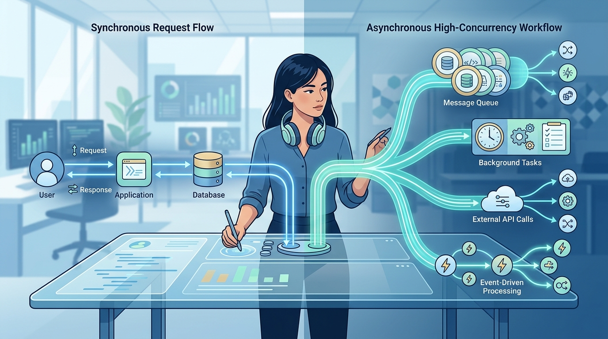
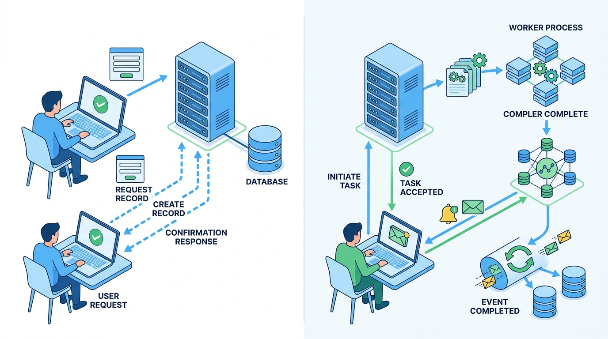

> Korean version: [Spring Boot에서 비동기 처리는 언제 필요할까? 꼭 써야 하는 경우와 아닌 경우](/posts/when-to-use-async-processing-in-spring-boot/)

> This is part 4 of the Spring/WebFlux series, following **[Spring MVC vs WebFlux](/posts/spring-mvc-vs-webflux-when-to-use-en/)**, **[Blocking vs Non-Blocking](/posts/blocking-vs-non-blocking-in-backend-en/)**, and **[Mono vs Flux](/posts/mono-vs-flux-in-spring-webflux-en/)**. Here the focus shifts from terminology to a practical engineering question: when is async processing actually worth the trouble?

At some point, most Spring Boot developers start asking the same questions:

- Will async processing make my service faster?
- Should every API become asynchronous?
- When should I use `@Async`, a queue, or WebFlux?
- When is synchronous code still the better choice?

Because words like async, reactive, and non-blocking are everywhere, it is easy to get the wrong impression that “more asynchronous” automatically means “better architecture.”

In practice, that is not how it works.

**Async processing is powerful when it solves a real waiting or workflow problem. If you introduce it without a clear need, you often get more complexity than value.**

## Quick summary

The practical decision points are these:

- **For ordinary CRUD applications, synchronous processing is often enough.**
- **Async becomes useful when response work and follow-up work should be separated.**
- **It also matters when external waiting is long or background jobs are naturally better than request-time work.**
- **Making everything async is rarely a good design goal by itself.**
- **Before changing architecture, check where the real bottleneck is.**



## Why async exists in the first place

Async processing is not there to make code look advanced. It exists because some work does not fit neatly into a single request-response cycle.

Typical examples:

- sending an email after signup
- pushing notifications after an order completes
- generating thumbnails after file upload
- producing a report that takes a long time
- calling slow external systems
- handling real-time or streaming workflows

These cases usually have one thing in common:

**the user does not always need to wait for every downstream step to finish before getting a response.**

## Do normal CRUD services need async?

Very often, no.

For many admin systems, internal tools, content systems, and ordinary business APIs, a synchronous flow is still the most practical choice.

Why?

- the request flow is clear
- debugging is easier
- error handling is more straightforward
- the team can move faster with familiar patterns

For a simple endpoint like this:

```java
@GetMapping("/orders/{id}")
public OrderResponse getOrder(@PathVariable Long id) {
    return orderService.findById(id);
}
```

there is usually no benefit in forcing async behavior just because it sounds modern.

If the system is not struggling, added complexity is usually a net loss.

## When async processing really makes sense

This is where async becomes valuable.

## 1. When the response and the follow-up work should be separated

Sometimes the client only needs confirmation that the request was accepted.

The expensive work can happen afterward.

Examples:

- signup completes, then a welcome email is sent
- order is placed, then notifications are pushed
- a file is uploaded, then thumbnails are generated
- a report request is accepted, then report generation runs in the background

This is one of the most practical places to use async patterns.

## 2. When external API waiting dominates response time

Some services do not spend much time computing, but they spend a lot of time waiting:

- payment gateways
- identity providers
- shipping APIs
- partner systems

If those waits are long and frequent, async or non-blocking design becomes more attractive—especially under high concurrency.

## 3. When the work naturally belongs in the background

Some tasks simply do not belong inside a normal request cycle:

- large file processing
- video encoding
- bulk data aggregation
- PDF generation
- AI inference pipelines

For work like this, the better user flow is often:

- request accepted
- job started
- status tracked separately
- result retrieved later or delivered by notification

That is not just a performance choice. It is often a better product experience too.

## 4. When concurrency or streaming is a core requirement

For live notifications, SSE, chat, event streams, or large numbers of concurrent long-lived connections, the conversation moves beyond “should I use `@Async`?”

At that point, a more reactive model such as WebFlux may make more sense.



## When async is probably unnecessary

It is just as important to know when **not** to introduce async.

### 1. When there is no confirmed bottleneck yet

“Traffic might grow later” is not a strong enough reason by itself.

Building complexity ahead of real need often backfires.

### 2. When the team is not ready for the operational cost

Async design is not just about code. It raises operational questions too:

- how are failures retried?
- how are stuck jobs found?
- how do logs and traces follow the work?
- what happens if downstream systems are temporarily unavailable?

Those are real responsibilities, not side notes.

### 3. When most requests are short and simple

If the majority of endpoints are small CRUD actions with quick response times, synchronous flow may still be the best trade-off.

### 4. When debuggability matters more than architectural sophistication

Simple request-response code is often easier to trace during incidents. That matters a lot in production.

## Async options in Spring Boot are not all the same

When people say “async in Spring Boot,” they may mean very different things.

### `@Async`

This is often the simplest starting point when you want to separate a follow-up action from the main response.

It can be a reasonable fit for things like email sending or lightweight post-processing.

### Message queues

If you need stronger durability, retry behavior, or better decoupling, queue-based patterns with tools like Kafka or RabbitMQ are often more appropriate.

### WebFlux

If the real issue is high-concurrency I/O or streaming, then the conversation is no longer just about background jobs. It becomes a broader reactive architecture discussion.

That is a much bigger change than just adding `@Async`.

## A practical checklist

Async is worth evaluating if most of these are true:

- response work and follow-up work should be separated
- external waiting contributes heavily to latency
- long-running work should move to the background
- concurrency or streaming is a meaningful requirement
- the team is prepared to operate retries, timeouts, and monitoring properly

Synchronous design is still probably better if most of these are true:

- the service is mostly CRUD
- there is no measured bottleneck yet
- code clarity and maintenance matter more than specialized concurrency handling
- the team has limited async operational experience

## One-sentence takeaway

**Async processing is not something you add because it sounds better. You add it when waiting, background work, or concurrency patterns make synchronous flow the wrong shape for the problem.**

## Final thoughts

Spring Boot gives you several ways to introduce async behavior, but the right question is never “How do I make everything asynchronous?”

The better question is:

**Which parts of this workflow actually benefit from being decoupled from the request-response path?**

That usually leads to better decisions.

A practical summary looks like this:

- **ordinary CRUD often does not need async**
- **background follow-up work often does**
- **long waits and streaming push you toward more async-friendly models**
- **operational complexity has to be part of the decision**

The next post takes that same practical lens into data access with **[JPA vs R2DBC in Spring](/posts/jpa-vs-r2dbc-in-spring-en/)**.

---

## Spring/WebFlux series

1. [Spring MVC vs WebFlux: When Should You Use Each?](/posts/spring-mvc-vs-webflux-when-to-use-en/)
2. [Blocking vs Non-Blocking in Backend Systems: What Actually Matters?](/posts/blocking-vs-non-blocking-in-backend-en/)
3. [Mono vs Flux in Spring WebFlux: The Core Idea in Plain English](/posts/mono-vs-flux-in-spring-webflux-en/)
4. [When Do You Actually Need Async Processing in Spring Boot?](/posts/when-to-use-async-processing-in-spring-boot-en/)
5. [JPA vs R2DBC in Spring: Which One Fits Your Application?](/posts/jpa-vs-r2dbc-in-spring-en/)
6. [WebFlux in Production: Pitfalls to Watch Before You Adopt It](/posts/webflux-production-pitfalls-en/)
