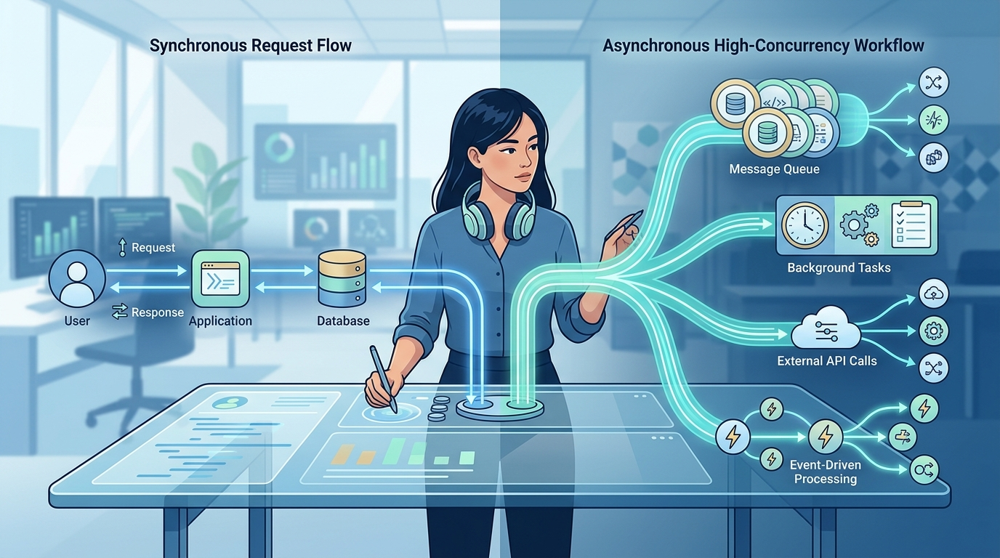
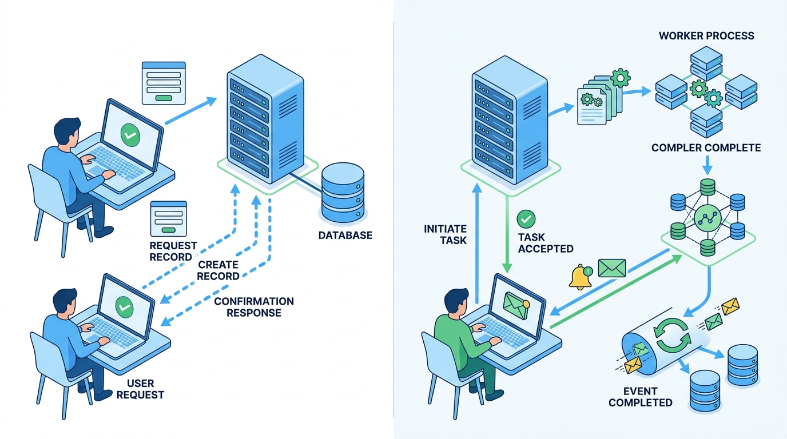

> 이 글은 **[Spring MVC vs WebFlux, 언제 무엇을 써야 할까? 차이점 쉽게 정리](/posts/spring-mvc-vs-webflux-when-to-use/)**, **[Blocking vs Non-blocking, 백엔드 개발자라면 꼭 알아야 할 차이](/posts/blocking-vs-non-blocking-in-backend/)**, **[Mono와 Flux란 무엇일까? Spring WebFlux를 이해하기 위한 핵심 개념 정리](/posts/mono-vs-flux-in-spring-webflux/)** 에 이어지는 Spring 시리즈 4편입니다.

Spring Boot를 공부하다 보면 어느 시점엔 꼭 이런 고민을 하게 됩니다.

- 비동기 처리를 쓰면 성능이 더 좋아질까?
- 모든 API를 비동기로 바꾸는 게 더 좋은 걸까?
- @Async, WebFlux, 메시지 큐는 각각 언제 써야 할까?
- 반대로 굳이 비동기를 안 써도 되는 경우는 언제일까?

요즘은 비동기, 논블로킹, 리액티브 같은 단어가 워낙 자주 등장하다 보니, 마치 무조건 도입해야 더 좋은 구조처럼 느껴질 때가 있습니다. 하지만 실무에서는 꼭 그렇지만은 않습니다.

결론부터 말하면, **비동기 처리는 필요한 문제를 풀 때 강력하지만, 문제도 없는데 먼저 도입하면 오히려 구조와 운영 복잡도만 높아질 수 있습니다.**

이번 글에서는 Spring Boot에서 비동기 처리가 진짜 필요한 경우와, 굳이 복잡하게 가져가지 않아도 되는 경우를 실무 기준으로 정리해보겠습니다.

## 먼저 결론부터

시간이 없으시면 아래 내용만 먼저 보셔도 됩니다.

- **일반적인 CRUD 서비스라면 동기 처리만으로도 충분한 경우가 많습니다.**
- **대기 시간이 긴 외부 작업이 많거나, 응답을 즉시 끝내고 후속 처리를 분리해야 할 때 비동기가 유용합니다.**
- **모든 것을 비동기로 만드는 것이 항상 좋은 설계는 아닙니다.**
- **비동기 도입 전에는 병목이 어디인지 먼저 확인해야 합니다.**
- **단순한 서비스라면 구조 단순성이 성능 최적화보다 더 중요할 수 있습니다.**



## 비동기 처리가 필요한 이유는 무엇인가

비동기 처리는 멋있어 보여서 도입하는 기술이 아닙니다. 보통은 **기다리는 시간이 길거나, 응답과 후속 작업을 분리할 필요가 있을 때** 등장합니다.

대표적으로 아래 같은 경우입니다.

- 외부 API 호출이 오래 걸릴 때
- 이메일, 알림, 로그 적재 같은 후속 작업을 응답과 분리하고 싶을 때
- 파일 업로드 후 변환 작업이나 배치 작업이 오래 걸릴 때
- 많은 동시 요청을 더 효율적으로 처리해야 할 때
- 스트리밍, 이벤트 기반 처리, 메시징 구조가 필요한 때

즉, 비동기는 "코드를 어렵게 만드는 선택"이 아니라 **대기와 처리 흐름을 분리하기 위한 선택**에 가깝습니다.

## 일반적인 CRUD 서비스는 꼭 비동기가 필요할까

대부분의 경우는 **아닙니다.**

게시판, 관리자 페이지, 일반적인 사내 시스템, 쇼핑몰 백오피스처럼 전형적인 CRUD 중심 서비스는 동기 처리만으로도 충분한 경우가 많습니다.

왜냐하면 이런 서비스는 보통 아래 특성을 가집니다.

- 한 요청에서 하는 일이 비교적 명확함
- 요청-응답 흐름이 단순함
- 디버깅과 유지보수가 중요함
- 팀이 익숙한 구조가 더 생산적임

이런 상황에서 비동기를 무리하게 넣으면, 얻는 이점보다 복잡도가 더 커질 수 있습니다.

예를 들어 단순한 조회 API라면 아래처럼 동기 방식이 오히려 더 명확합니다.

```java
@GetMapping("/orders/{id}")
public OrderResponse getOrder(@PathVariable Long id) {
    return orderService.findById(id);
}
```

이 정도의 흐름에서는 성급하게 비동기를 붙이기보다, 먼저 실제 병목이 있는지 보는 편이 훨씬 현실적입니다.

## 그렇다면 언제 비동기가 진짜 필요할까

이제부터가 중요합니다. 실무에서 비동기가 빛나는 순간은 보통 아래와 같습니다.

## 1. 응답과 후속 작업을 분리해야 할 때

사용자에게는 응답을 빨리 돌려주고, 뒤에서는 시간이 걸리는 작업을 계속 처리해야 할 때가 있습니다.

예를 들면,

- 회원가입 후 환영 메일 발송
- 주문 완료 후 알림 발송
- 이미지 업로드 후 썸네일 생성
- 보고서 생성 요청 후 백그라운드 처리

이런 경우 사용자는 "요청이 접수됐다"는 응답만 빨리 받으면 됩니다. 실제 후속 작업은 꼭 같은 요청 흐름 안에서 끝낼 필요가 없습니다.

이때는 `@Async`, 큐 기반 작업, 이벤트 발행 같은 방식이 잘 맞을 수 있습니다.

## 2. 외부 API 대기가 길 때

내 서비스의 CPU 연산은 많지 않은데, 외부 결제 API, 인증 API, 배송 API처럼 다른 시스템 응답을 기다리는 시간이 긴 경우가 있습니다.

이런 상황에서는 대기 시간이 누적되면서 전체 응답성이 나빠질 수 있습니다.

특히 동시 요청이 많은 환경이라면, 이런 대기 시간을 더 효율적으로 다루는 구조가 필요해질 수 있습니다.

이때는 비동기 호출, 논블로킹 I/O, WebFlux 같은 접근을 검토할 이유가 생깁니다.

## 3. 오래 걸리는 작업을 요청 흐름에서 분리해야 할 때

아래처럼 시간이 꽤 걸리는 작업은 요청-응답 안에서 억지로 끝내려 하면 불편해집니다.

- 대용량 파일 처리
- 영상 인코딩
- 대규모 데이터 집계
- PDF/리포트 생성
- AI 추론 요청 후 결과 저장

이런 작업은 사용자가 브라우저에서 계속 기다리는 구조보다,

- 요청 접수
- 작업 시작
- 진행 상태 확인
- 완료 후 알림 또는 결과 조회

이런 방식이 더 잘 맞습니다.

## 4. 높은 동시성과 스트리밍 처리가 중요할 때

실시간 알림, SSE, 채팅, 로그 스트리밍처럼 많은 연결과 이벤트 흐름을 다뤄야 한다면 동기적인 단순 request-response 구조보다 비동기/리액티브 모델이 더 잘 맞을 수 있습니다.

이때는 단순히 `@Async` 수준이 아니라, 아예 WebFlux 같은 모델을 검토하게 됩니다.



## 비동기를 굳이 안 써도 되는 경우

반대로 아래 같은 상황에서는 굳이 비동기를 넣지 않아도 됩니다.

### 1. 병목이 아직 확인되지 않았을 때

이게 정말 중요합니다.

"나중에 트래픽 많아질 수도 있으니까" 정도의 이유만으로 비동기를 먼저 넣으면, 아직 없는 문제를 위해 복잡도부터 안게 됩니다.

### 2. 팀이 운영 복잡도를 감당하기 어려울 때

비동기는 개발만의 문제가 아닙니다.

- 예외 처리를 어떻게 할지
- 재시도를 어떻게 할지
- 실패한 작업을 어떻게 추적할지
- 로그와 모니터링을 어떻게 할지

이런 운영 문제가 함께 따라옵니다.

### 3. 대부분이 짧고 단순한 요청일 때

조회, 등록, 수정, 삭제 위주의 API가 대부분이고 응답도 빠르다면, 구조 단순성이 더 큰 장점이 됩니다.

### 4. 디버깅과 명확한 흐름이 특히 중요한 시스템일 때

비동기 흐름은 익숙하지 않으면 추적이 어려워질 수 있습니다. 장애 대응이 매우 중요한 시스템이라면 단순한 동기 구조가 오히려 유리할 수 있습니다.

## Spring Boot에서는 어떤 방식의 비동기를 생각할 수 있을까

Spring Boot에서 비동기라고 하면 하나만 있는 게 아닙니다. 목적에 따라 접근이 다릅니다.

### `@Async`

응답과 후속 작업을 간단히 분리하고 싶을 때 가장 먼저 떠올릴 수 있는 방식입니다.

예를 들어 메일 발송처럼 즉시 응답과 분리 가능한 작업에 잘 맞습니다.

### 메시지 큐

작업을 더 안정적으로 분리하고, 재시도나 확장성을 확보하고 싶다면 Kafka, RabbitMQ 같은 메시지 큐 기반 접근이 더 잘 맞을 수 있습니다.

### WebFlux

대기 시간이 긴 I/O 작업과 높은 동시성, 스트리밍 응답까지 고려해야 한다면 WebFlux를 검토하게 됩니다. 다만 이건 단순 비동기 처리 이상의 구조 변화라고 보는 편이 맞습니다.

## 실무에서 빠르게 판단하는 기준

아래 질문에 대부분 예라면 비동기 처리를 검토할 가치가 있습니다.

- 응답과 후속 작업을 분리할 필요가 있는가?
- 외부 API 대기 시간이 전체 응답에 큰 영향을 주는가?
- 오래 걸리는 작업을 백그라운드로 넘기는 편이 더 자연스러운가?
- 동시 연결 수와 스트리밍 처리 요구가 큰가?
- 비동기 처리 실패, 재시도, 모니터링까지 운영할 준비가 되어 있는가?

반대로 아래 질문에 대부분 예라면, 아직은 동기 구조가 더 현실적일 수 있습니다.

- 대부분이 일반적인 CRUD인가?
- 현재 병목이 명확하지 않은가?
- 구조 단순성과 유지보수가 더 중요한가?
- 팀이 비동기 운영 경험이 많지 않은가?

## 한 줄 요약

**비동기 처리는 무조건 더 좋은 기술이 아니라, 기다림과 후속 작업 분리가 실제 문제일 때 쓰는 도구입니다.**

즉, 문제를 해결하기 위해 써야지, 기술 자체를 도입하는 것이 목적이 되면 오히려 불편해질 수 있습니다.

## 마무리

Spring Boot에서 비동기 처리는 분명 강력한 도구입니다. 하지만 모든 문제의 정답은 아닙니다.

정리하면 이렇습니다.

- **일반적인 CRUD 서비스는 동기 처리만으로도 충분할 수 있습니다.**
- **후속 작업 분리, 외부 I/O 대기, 스트리밍 처리에서는 비동기가 강력합니다.**
- **비동기 도입 전에는 병목이 실제로 있는지 먼저 확인해야 합니다.**
- **운영 복잡도까지 감당할 수 있을 때 도입해야 합니다.**

다음 글에서는 여기서 한 단계 더 들어가서, **[JPA와 R2DBC의 차이점](/posts/jpa-vs-r2dbc-in-spring/)** 을 통해 왜 WebFlux 환경에서는 데이터 접근 방식까지 같이 고민해야 하는지 정리해보겠습니다.

---

## Spring/WebFlux 시리즈 전체 보기

1. [Spring MVC vs WebFlux, 언제 무엇을 써야 할까?](/posts/spring-mvc-vs-webflux-when-to-use/)
2. [Blocking vs Non-blocking, 백엔드 개발자라면 꼭 알아야 할 차이](/posts/blocking-vs-non-blocking-in-backend/)
3. [Mono와 Flux란 무엇일까? Spring WebFlux를 이해하기 위한 핵심 개념 정리](/posts/mono-vs-flux-in-spring-webflux/)
4. [Spring Boot에서 비동기 처리는 언제 필요할까? 꼭 써야 하는 경우와 아닌 경우](/posts/when-to-use-async-processing-in-spring-boot/)
5. [JPA와 R2DBC 차이점 정리, Spring에서 무엇을 선택해야 할까?](/posts/jpa-vs-r2dbc-in-spring/)
6. [WebFlux를 실무에 도입할 때 주의할 점, 시작 전에 꼭 봐야 할 체크포인트](/posts/webflux-production-pitfalls/)
